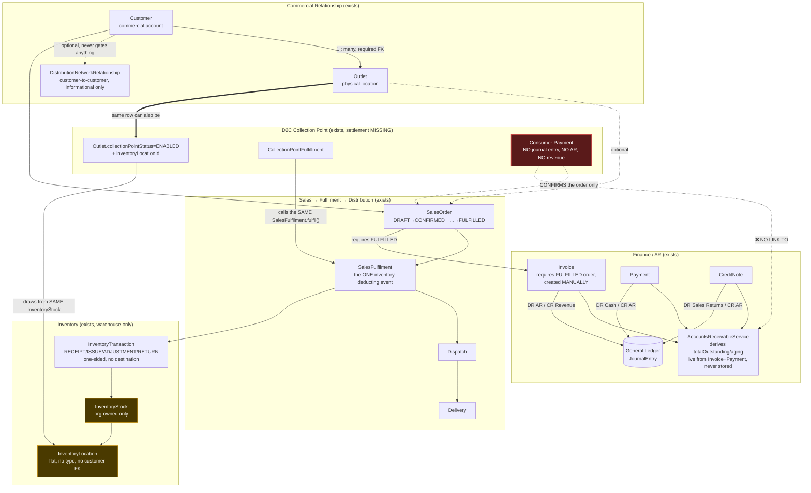
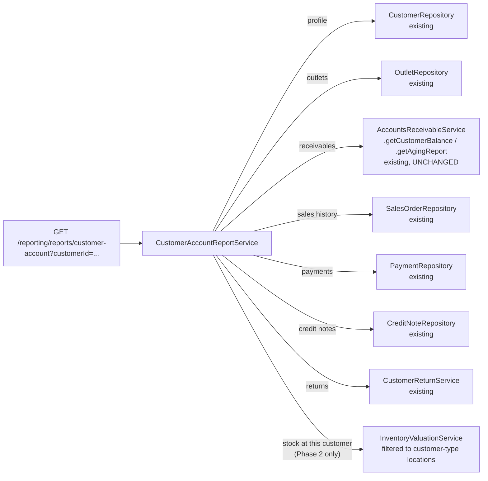

# Customer Account, Outlet Inventory & Trade Relationship Audit

**Status:** Audit and design proposal, as originally written below — nothing in this
document's findings or recommendations has been rewritten. **Phase 1 of the roadmap
proposed in §14 has since been implemented** (unified Customer Account view,
reconciling Customer Statement, warning-only credit limits, multi-invoice payment
allocation) — see
[`docs/sprint-customer-account-phase-1-completion-report.md`](sprint-customer-account-phase-1-completion-report.md)
for exactly what was built, what deviated from this proposal and why (none did,
materially), and what remains deferred. Phases 2 and 3 (§14) remain entirely
unimplemented. The audit evidence and recommendations below are preserved verbatim
as a historical record of the pre-Phase-1 state.

**Scope:** Pre-Sprint-47 investigation requested to determine whether Zentuva already
provides a complete operational account for each B2B customer (sales history,
invoices, payments, credit, returns, and customer-held inventory), and to propose the
smallest reliable extension of the existing architecture if it does not.

**Method:** Direct inspection of `apps/api/prisma/schema.prisma`, the relevant NestJS
services/repositories/controllers, `packages/validation`, the existing domain
documentation (`docs/domains/*.md`), and the relevant frontend pages. Every claim
below cites an exact file, model, or route. Where a capability does not exist, that is
stated explicitly rather than inferred from the absence of a page. No `CLAUDE.md` file
exists in this repository (checked at the repo root and two levels down) — the
engineering handbook (`docs/handbook/engineering-handbook.md`) and the domain docs
were read instead.

---

## 1. Executive Summary

Zentuva already has a **genuinely strong foundation** for B2B customer management:
`Customer` and `Outlet` are cleanly separated (commercial account vs. physical
location), a full Sales → Fulfilment → Invoice → Payment → Accounts Receivable chain
exists and is GL-reconciled, Customer Returns and Credit Notes are fully built, and a
Reporting module (Sprint 45/46) already establishes the exact composition pattern a
"Customer Account View" should reuse.

Three capabilities the business problem statement assumes exist **do not exist
anywhere in the codebase, confirmed by exhaustive search, not inference**:

1. **No credit limit of any kind.** No `Customer.creditLimit` field, no enforcement
   check, no warning. An order or invoice for a customer with unlimited overdue debt
   proceeds freely today.
2. **No customer-held inventory tracking.** Once goods leave a Boby Bites warehouse
   (B2B fulfilment) or are consumed by a D2C Collection Point order, the system's last
   word on that stock is a one-sided `ISSUE` ledger row. There is no field, model, or
   report anywhere that answers "how much Boby Bites product does Customer X currently
   hold."
3. **No Collection Point settlement relationship.** This is not an oversight — it was
   explicitly audited and deliberately deferred at Sprints 36, 37, and 42, and the
   deferral was never closed. A consumer's payment to Boby Bites today creates **zero
   general-ledger impact** (D2C orders are never invoiced), and the only accounting
   event in the entire Collection Point flow is the COGS entry inventory fulfilment
   already posts. No commission, payable, or receivable between Boby Bites and the
   outlet exists anywhere in schema, code, or documentation.

The recommended first move is **not** a new subsystem. It is extending the `Customer`
model with four fields (credit limit, default payment terms, a credit hold flag, a
sales-rep assignment) and building one new, read-only, permission-gated **Customer
Account report** inside the _existing_ Reporting module (`apps/api/src/reporting/`) —
reusing `AccountsReceivableService`, `AccountsPayableService`-equivalent patterns,
`SalesOrderRepository`, `PaymentRepository`, and `CreditNoteRepository` exactly as
`ExecutiveDashboardService` already reuses Finance's services. This is Phase 1 (§14)
and requires no new balance-calculation engine, no new inventory engine, and touches
no existing business-logic method.

Customer-held inventory (Phase 2) and Collection Point settlement (Phase 3) are
real, separately-scoped extensions with genuine open business questions — this
document proposes concrete options for both rather than inventing an answer.

---

## 2. Current-State Architecture and Data Flow



**Reading the diagram:** everything in the Commercial, Sales/Fulfilment/Distribution,
and Finance/AR boxes is real, tested, GL-reconciled, and already production-quality.
The red box (consumer payment) is financially disconnected from the outlet. The amber
boxes (inventory) have no concept of "whose stock this is" once it leaves a Boby
Bites-controlled location — a Collection Point's shelf is, today, invisibly treated as
just another corner of Boby Bites' own warehouse.

---

## 3. Evidence-Backed Audit

### 3.1 Customer, Outlet, Territory, Distribution Network (Phase A)

| Question                                                                    | Answer                                                                                                                                                                                                                                                                                                                                                                                                                                                                                                                                                                        | Evidence                                                                                                    |
| --------------------------------------------------------------------------- | ----------------------------------------------------------------------------------------------------------------------------------------------------------------------------------------------------------------------------------------------------------------------------------------------------------------------------------------------------------------------------------------------------------------------------------------------------------------------------------------------------------------------------------------------------------------------------- | ----------------------------------------------------------------------------------------------------------- |
| What does `Customer` represent?                                             | The commercial account — who is billed.                                                                                                                                                                                                                                                                                                                                                                                                                                                                                                                                       | `prisma/schema.prisma:1838-1904`, doc comment: "the COMMERCIAL ACCOUNT"                                     |
| Is `Outlet` a location, an account, or both?                                | A physical location only. `customerId` is **required and immutable** after creation.                                                                                                                                                                                                                                                                                                                                                                                                                                                                                          | `schema.prisma:1906-1997`; `OutletService` enforces immutability                                            |
| Can one customer have multiple outlets?                                     | Yes — true one-to-many, `Customer.outlets Outlet[]`.                                                                                                                                                                                                                                                                                                                                                                                                                                                                                                                          | `schema.prisma:1897`                                                                                        |
| Can an outlet be linked unambiguously to its commercial customer?           | Yes at the service layer (`SalesOrderService.assertOutletBelongsToCustomer`, `sales-order.service.ts:329-344`). **No DB-level CHECK constraint** ties `SalesOrder.outletId` to `SalesOrder.customerId` — coherence is service-enforced only, not schema-enforced.                                                                                                                                                                                                                                                                                                             | `sales/sales-order.service.ts:329-344`                                                                      |
| Can a distributor have subordinate outlets without duplicating the account? | **Not in the sense the brief implies.** `DistributionNetworkRelationship` links two independent `Customer` rows (`sourceCustomer --[DISTRIBUTES_TO\|WHOLESALES_TO\|SUPPLIES\|OTHER]--> targetCustomer`) — it is a **market-intelligence graph**, not an account hierarchy. It never gates orders, is never consulted by `SalesOrderService` (`SalesModule` does not import `NetworkRelationshipModule` — structurally enforced, see `sales/direct-sales-independence.spec.ts`), and does not represent "Distributor X's outlets" — each `Customer` remains fully independent. | `schema.prisma:2034-2077`; `docs/domains/retail-network.md` §2-3                                            |
| Can one Outlet be both a B2B outlet and a D2C Collection Point?             | Yes — the same `Outlet` row carries both B2B fields and `collectionPointStatus`/`inventoryLocationId`/`collectionPointResponsibleUserId`/`collectionPointOperatingHours`. No separate entity.                                                                                                                                                                                                                                                                                                                                                                                 | `schema.prisma:1935-1972`                                                                                   |
| Are credit terms, credit limits, tax info, billing details represented?     | **No.** `Customer`'s full field list (`customerCode`, `customerType`, `customerName`, `contactPersonName`, `phoneNumber`, `alternatePhoneNumber`, `email`, `address`, `city`, `state`, `country`, `territoryId`, `status`, `notes`) contains none of these.                                                                                                                                                                                                                                                                                                                   | `schema.prisma:1850-1878`                                                                                   |
| Can staff see a chronological transaction history for a customer?           | Partially. `GET /retail/customers/:id` returns the bare row (no `include`, `customer.repository.ts:31-33`). `GET /retail/outlets?customerId=` and `GET /sales/orders?customerId=` work. A per-customer AR balance exists (`GET /finance/receivables/customers/:id`). **No single endpoint composes all of this.**                                                                                                                                                                                                                                                             | See §3.2, §3.5                                                                                              |
| Can the system distinguish who owes money from where stock is held?         | Conceptually yes (Customer vs. Outlet), but **stock-at-outlet is not tracked at all** — see §3.3.                                                                                                                                                                                                                                                                                                                                                                                                                                                                             | —                                                                                                           |
| What customer admin/search/detail pages exist?                              | `settings/retail` (Customers/Outlets/Territories/Network tabs, flat tables, no drill-down route) and a thin Field Sales customer detail page (`(field)/field/customers/[id]/page.tsx` — header + Outlets + Recent Orders only, **no finance, no inventory**). **No "customer 360" page exists anywhere** (zero hits for `customer-360`/`customer360`).                                                                                                                                                                                                                        | `apps/web/src/app/(app)/settings/retail/page.tsx`; `apps/web/src/app/(field)/field/customers/[id]/page.tsx` |

**`CustomerType` enum** (`DISTRIBUTOR`/`WHOLESALER`/`RETAILER`/`SUPERMARKET`/
`CORPORATE`/`INSTITUTION`/`RESTAURANT`/`HOTEL`/`OTHER`, `schema.prisma:1684-1694`) is
confirmed **purely descriptive** — no code path anywhere branches on it.

**Sales-rep assignment**: there is no `Customer → Employee` or `Outlet → Employee`
field. The only "responsible person" data is `SalesOrder.salesAgentId` (per-order,
plain id, no FK) and the transitive, optional `Employee.territoryId` ↔
`Customer.territoryId`/`Outlet.territoryId` match — which is not even enforced to
agree between a customer and its own outlets.

### 3.2 Sales, Invoicing, Credit, and Payment (Phase B)

**The order → receivable boundary is correctly separated, confirmed at the code
level, not just by convention:**

- Creating or confirming a `SalesOrder` posts **nothing** — no journal entry, no AR
  impact (`sales-finance-independence.spec.ts`, `direct-sales-independence.spec.ts`).
- `Invoice.create()` requires `SalesOrder.status === FULFILLED` (not merely
  `CONFIRMED`) and rejects a second invoice for the same order
  (`invoice.service.ts:87-111`). **Invoicing is a separate, manual Finance action** —
  never automatic on fulfilment.
- `Invoice.amountOutstanding` is **never stored** — every read site computes
  `total - amountPaid - amountCredited` live (`invoice.repository.ts:210`,
  `payment.service.ts:59`, confirmed by schema comment at `schema.prisma:2728`).

| Question                                                                      | Answer                                                                                                                                                                                                                                                                                                                                                                             |
| ----------------------------------------------------------------------------- | ---------------------------------------------------------------------------------------------------------------------------------------------------------------------------------------------------------------------------------------------------------------------------------------------------------------------------------------------------------------------------------- |
| Can Zentuva calculate what a customer owes?                                   | Yes — `AccountsReceivableService.getSummary()`/`.getAgingReport()`/`.getCustomerBalance()` (`finance/accounts-receivable.service.ts`), derived live via `groupBy`/`aggregate` over `Invoice`/`Payment`, never a stored balance.                                                                                                                                                    |
| Is that figure authoritative or manually editable?                            | Authoritative — no manually-editable balance field exists anywhere.                                                                                                                                                                                                                                                                                                                |
| Can a payment be split across multiple invoices?                              | **Schema-ready, service-blocked.** `PaymentAllocation` (`invoiceId`, `paymentId`, `amount`) is a true join table (`schema.prisma:2915-2933`), but `paymentCreateSchema` accepts a single scalar `invoiceId` (`packages/validation/src/finance.ts:94`) and `PaymentRepository.create()` only ever writes one allocation row — a deliberate "Sprint 6 limitation," not a schema gap. |
| Can staff see paid/unpaid/partial/overdue invoices?                           | Yes — `InvoiceStatus` (`DRAFT`/`ISSUED`/`PARTIALLY_PAID`/`PAID`/`OVERDUE`/`VOID`) plus the aging report. `OVERDUE` is a **lazy read-time sweep** (`invoice.service.ts`, `sweepOverdue()`), not a scheduled job.                                                                                                                                                                    |
| Can the system enforce a credit limit before confirming/fulfilling/invoicing? | **No — the field does not exist.** Exhaustive `grep -rni "creditLimit\|credit_limit"` across the entire repository (code, schema, SQL) returns zero matches outside documentation explicitly stating it is out of scope (`docs/domains/finance.md:223,354`, `docs/domains/accounting.md:554`, `docs/sprint-10-completion-report.md:235`).                                          |
| Can it flag a customer who has exceeded a limit?                              | No — there is nothing to exceed.                                                                                                                                                                                                                                                                                                                                                   |
| Can it calculate outstanding balance and aging accurately?                    | Yes, confirmed — `getAgingReport()` buckets (current/1-30/31-60/61-90/90+) sum exactly to `totalOutstanding`, GL-reconciled.                                                                                                                                                                                                                                                       |
| Can it produce a customer statement (opening balance → closing balance)?      | **No — does not exist anywhere.** The closest thing, `GET /finance/receivables/customers/:id`, returns four aggregate numbers only (`totalInvoiced`/`totalPaid`/`totalCredited`/`totalOutstanding`) — no transaction list, no date range, no opening/closing balance.                                                                                                              |
| Are returns/credit notes reflected in AR and the GL correctly?                | Yes. `CreditNote.issue()` increments `Invoice.amountCredited`, recomputes status, and posts `DR SALES_RETURNS / CR AR` atomically (`credit-note.repository.ts:200-225`). `CustomerReturn.receive()` (Sprint 11) separately posts COGS reversal and credit-note issuance in one transaction.                                                                                        |

**No unallocated-payment / customer-advance concept exists.** A `Payment` requires an
eligible, existing invoice to attach to (`payment.service.ts:54-64`); a payment
received with no invoice to apply cannot be recorded at all today. (Structurally,
`Payment` itself has no required `invoiceId` — the requirement is service-layer, which
means this is a smaller gap to close than it might appear — see §7.)

**Payment terms are per-invoice, not per-customer.** `PaymentTermType`
(`CASH`/`DUE_ON_RECEIPT`/`NET_7`/`NET_14`/`NET_30`) is chosen by the preparer at each
invoice's creation; `Customer` carries no default (`finance.md` §5, confirmed in
schema).

**Idempotency**: `idempotencyKey` fields on `Invoice`/`Payment`/`CreditNote` are
**optional and client-supplied** — a client that omits one gets no duplicate
protection beyond the service-level business rules (one invoice per order, over-
application guards). This is a pre-existing, codebase-wide pattern, not specific to
this audit's scope, but worth flagging since a credit/statement feature will surface
it more visibly.

### 3.3 Inventory and Customer/Outlet Stock Accountability (Phase D)

**This is the audit's most significant negative finding, confirmed exhaustively, not
inferred.**

- `InventoryLocation` (`schema.prisma:1008-1053`) has exactly: `id`, `organisationId`,
  `name`, `status`, `isDefault`, audit columns. **No `type`/`locationType` field. No
  `customerId`/`outletId` field.** The model's own doc comment calls it "deliberately
  not a full Warehouse Management System... no transfers between locations yet."
- `InventoryStock` (`schema.prisma:1276-1314`) is keyed `(organisationId, productId,
locationId)` — it has **no customer dimension of any kind**. Any row is
  indistinguishable from Boby Bites' own warehouse stock.
- `InventoryTransaction` (`schema.prisma:1351-1399`) has exactly one `locationId` — no
  `destinationLocationId`. `InventoryTransactionType` is `RECEIPT`/`ISSUE`/
  `ADJUSTMENT`/`RETURN` — **no `TRANSFER` value exists**.
- `SalesFulfilmentRepository.create()` (`sales/sales-fulfilment.repository.ts:321-331`)
  writes a single-sided `ISSUE` transaction against the source warehouse when a B2B
  order is fulfilled. **Nothing records that the goods are now physically at the
  customer.** The ledger's last word on that stock is "it left."
- `Outlet.inventoryLocationId` (the Collection Point bridge, `schema.prisma:1959-1972`)
  points **into** Boby Bites' own `InventoryLocation`/`InventoryStock` pool, not a
  customer-owned one. A Collection Point's "stock" is, today, simply more Boby
  Bites-owned inventory that happens to be shelved at a particular named location —
  there is no mechanism recording that the outlet received it via a commercial
  transaction, and a B2B sale to that same outlet's `Customer` account does **not**
  increase its Collection Point stock (a B2B fulfilment only ever **decrements** a
  location).
- **No batch, lot, or expiry tracking exists anywhere in the inventory domain** —
  confirmed by a repo-wide field search; the only `expiryDate` columns in the entire
  schema belong to unrelated HR/Promotions models.
- **No stock-transfer mechanism exists between any two locations.** `InventoryService
.adjustStock()` (`inventory.service.ts:523`) is the nearest primitive — a single-
  location signed adjustment that deliberately does not touch `averageUnitCost`, so it
  cannot safely stand in for a transfer (cost would be lost).

### 3.4 Collection Points and Customer Accounts (Phase E)

**Already a self-documented, repeatedly-deferred, never-closed open question —
confirmed, not merely suspected.**

- `Outlet.collectionPointStatus`/`inventoryLocationId` are the only Collection Point
  configuration; eligibility requires `status=ACTIVE`, `collectionPointStatus=ENABLED`,
  a configured location, and a territory match
  (`collection-point-fulfillment.service.ts:649-671`).
- Stock fulfilment for a collected D2C order calls the **exact same**
  `SalesFulfilmentService.fulfil()` B2B uses, against `outlet.inventoryLocationId`
  (`collection-point-fulfillment.service.ts:344-357`) — reusing the accounting
  machinery verbatim, posting `DR COGS / CR Finished Goods Inventory`
  (`sales-fulfilment.repository.ts:363-376`).
- **The consumer's OPay payment creates a `Payment` row with zero journal-entry
  impact.** `docs/domains/d2c.md` §48 ("Finance Integration — A Deliberate
  Boundary," lines 1070-1086) states this explicitly: _"a D2C `SalesOrder` is never
  invoiced... there is no existing invoice-settlement, AR-reduction, or GL-journal-
  posting trigger that genuinely applies to an uninvoiced order."_ **D2C sales revenue
  is never recognized in the general ledger at all** — only the COGS leg posts, at
  fulfilment. This is distinct from, and in addition to, the Collection Point
  settlement gap.
- `grep -rni "commission|settlement|reimburs|payout"` across the entire `d2c/` module
  returns **zero hits**. No payable to the outlet, no receivable from the outlet, no
  revenue-share, no reimbursement mechanism exists in schema, code, or any migration.
- The documentation trail is unusually explicit about this being a known, intentional
  gap, not an omission: `docs/domains/d2c.md` §60 ("B2B Credit Boundary — Preserved,
  Not Reinterpreted," ~line 1377) states enabling a Collection Point does **not** mean
  "the outlet has paid for its existing B2B credit inventory... or that a consumer's
  OPay payment belongs to the outlet," and explicitly names this "Sprint 37's design
  problem, not solved (or guessed at) here." Sprint 37 then explicitly excluded
  settlement/payout from its own scope (§81, ~line 1818). Sprints 38-44 never revisited
  it. §123 (Sprint 42, ~line 2870) re-confirms: _"No settlement mechanism between a
  Collection Point outlet and the organisation was requested or built."_

**Conclusion:** the outlet is financially invisible on both legs of a Collection
Point transaction — it neither "sold" the stock to Boby Bites' system, nor "bought"
it, nor is compensated for handing it over.

### 3.5 Permissions and Existing UI (Phase F context)

The permission catalogue (`apps/api/src/identity/authorization/permission-catalogue.ts`)
already covers the relevant surfaces with the same `module.resource.action` /
`EffectiveAccessResolver` system this codebase has used since Sprint 25 — **this
supersedes the older domain docs** (`customers.md`/`sales.md`/`distribution.md`),
which still describe the original Sprint 4.8/4.9/5 `RolesGuard`-only design; the
routes have since been migrated. Relevant existing entries, confirmed by direct
inspection:

| Key                                                                | Scope    | Covers                                 |
| ------------------------------------------------------------------ | -------- | -------------------------------------- |
| `sales.customer.view` / `.manage`                                  | SCOPABLE | Customer + Outlet CRUD                 |
| `retail.network.manage`                                            | NONE     | DistributionNetworkRelationship        |
| `retail.territory.view` / `.manage`                                | NONE     | Territory                              |
| `finance.invoice.view` / `.create` / `.issue` / `.cancel`          | mixed    | Invoice lifecycle                      |
| `finance.payment.view` / `.create` / `.cancel`                     | mixed    | Payment lifecycle                      |
| `finance.credit_note.view` / `.manage`                             | mixed    | CreditNote lifecycle                   |
| `finance.reports.view`                                             | NONE     | AR summary/aging, financial statements |
| `inventory.stock.view` / `.adjustment.create` / `.location.manage` | mixed    | Inventory                              |
| `d2c.collection_point.view` / `.fulfil`                            | SCOPABLE | Collection Point queues                |

**No credit-limit or customer-statement permission exists** — there is nothing to
gate yet. `AuditService.record()` is already called from every relevant mutation
controller (`customer.controller.ts`, `invoice.controller.ts`, `payment.controller.ts`,
`credit-note.controller.ts`). Tenant isolation is confirmed standard throughout (every
repository method threads `organisationId`; cross-tenant reads 404, writes 403).

---

## 4. Capabilities Summary — What Exists, What's Partial, What's Missing

| Capability                                                  | Status                                   | Notes                                                     |
| ----------------------------------------------------------- | ---------------------------------------- | --------------------------------------------------------- |
| Customer/Outlet identity, classification, lifecycle         | ✅ Complete                              | §3.1                                                      |
| Customer ↔ Outlet linkage                                   | ✅ Complete (service-level)              | No DB CHECK constraint, acceptable risk                   |
| Distribution network (market intelligence)                  | ✅ Complete, by design never gates sales | §3.1                                                      |
| Sales Order → Fulfilment → Dispatch → Delivery              | ✅ Complete, GL-integrated               | §3.2                                                      |
| Invoice, Payment (single-allocation), Credit Note, AR aging | ✅ Complete, GL-reconciled               | §3.2                                                      |
| Customer Returns (disposition, COGS reversal, credit note)  | ✅ Complete                              | Sprint 11                                                 |
| Multi-invoice payment allocation                            | 🟡 Schema-ready, service-blocked         | One line of validation removed, not new modeling          |
| Customer advance / unallocated payment                      | 🟡 Schema-permits, service-blocked       | `Payment` has no required `invoiceId`                     |
| Per-customer default payment terms                          | ❌ Missing                               | Per-invoice only today                                    |
| Credit limit (field, calculation, enforcement)              | ❌ Missing entirely                      | Confirmed by exhaustive search                            |
| Customer statement (opening/closing balance, date range)    | ❌ Missing entirely                      | Only a 4-number aggregate exists                          |
| Customer → sales rep (Employee) assignment                  | ❌ Missing                               | Only per-order `salesAgentId`                             |
| Customer 360 / unified account view (any surface)           | ❌ Missing                               | No page, no endpoint                                      |
| Customer-held inventory (any form)                          | ❌ Missing entirely                      | Stock ledger is one-sided; no customer dimension anywhere |
| Stock transfer between locations                            | ❌ Missing                               | No model, no `TRANSFER` type                              |
| Batch/lot/expiry tracking                                   | ❌ Missing                               | Confirmed repo-wide absent                                |
| D2C revenue recognition in the GL                           | ❌ Missing                               | Only COGS posts; no AR, no revenue                        |
| Collection Point settlement/commission/reimbursement        | ❌ Missing, deliberately deferred 3x     | §3.4                                                      |

---

## 5. Proposed Customer Account Model

### 5.1 `Customer` model extension (additive, backward-compatible)

All new fields nullable/defaulted — every existing `Customer` row remains valid with
no backfill required.

```prisma
model Customer {
  // ...existing fields unchanged...

  creditLimit          Float?              // null = no limit configured (current behaviour, unchanged)
  creditHold           Boolean  @default(false)
  creditHoldReason     String?
  paymentTermsDefault  PaymentTermType?    // reuses the EXISTING enum from Invoice — no new enum
  salesRepEmployeeId   String?             // nullable FK -> Employee, SetNull on delete
  taxIdentificationNumber String?          // mirrors Supplier.taxIdentificationNumber's existing precedent
}
```

`paymentTermsDefault` reuses `PaymentTermType` (already defined for `Invoice`) —
`InvoiceService.create()` is extended to default `paymentTerms` from the customer's
own value when the caller omits it, never silently overriding an explicit choice.

### 5.2 Customer Account View — reuses the Reporting module, not a new engine

The single most important architectural decision in this proposal: **the Customer
Account View is a new report inside the existing `apps/api/src/reporting/` module**,
following the exact pattern `ExecutiveDashboardService` (Sprint 46) already
established — compose existing authoritative services, zero new calculation,
per-section permission gating.



Each section is independently permission-gated against its **own existing**
permission (`sales.customer.view` for profile/outlets, `finance.invoice.view` for the
financial sections, `inventory.stock.view` for the Phase-2 stock section) — identical
to how `ExecutiveDashboardService` already gates finance/sales/production/workforce
independently. A user who can see a customer's profile but not its finances sees
exactly that, never a 403 for the whole page, never a leaked figure.

### 5.3 Account Overview — precise metric definitions

| Metric                  | Definition                                                                                                                               | Source (unchanged)                                                                                                    |
| ----------------------- | ---------------------------------------------------------------------------------------------------------------------------------------- | --------------------------------------------------------------------------------------------------------------------- |
| Total Invoiced Sales    | Sum of `Invoice.total` for non-`VOID` invoices in period                                                                                 | `InvoiceRepository`                                                                                                   |
| Total Receipts          | Sum of allocated `Payment.amount` in period                                                                                              | `PaymentRepository`                                                                                                   |
| Outstanding Receivable  | `AccountsReceivableService.getCustomerBalance().totalOutstanding`                                                                        | unchanged                                                                                                             |
| Overdue Amount          | Sum of aging buckets `days1To30`..`days90Plus` for this customer                                                                         | `getAgingReport()`, customer-filtered                                                                                 |
| Available Credit        | `creditLimit - totalOutstanding` (displayed as `null`/"No limit set" when `creditLimit` is null — never shown as 0 or unlimited-looking) | new, derived, never stored                                                                                            |
| Pending Orders          | Count of `SalesOrder` in `CONFIRMED`/`PARTIALLY_FULFILLED` for this customer                                                             | `SalesOrderRepository`                                                                                                |
| Unfulfilled Order Value | Sum of `SalesOrderItem` lines not yet fulfilled × `unitPrice`                                                                            | new, derived — **explicitly distinct from Outstanding Receivable**, since an order is not a receivable until invoiced |

The brief's own warning is the load-bearing design rule here: **Unfulfilled Order
Value and Outstanding Receivable must never be added together or displayed as one
number** — they answer different questions ("what might this customer eventually owe"
vs. "what this customer owes right now, provable by an issued invoice").

### 5.4 Customer Statement

New report, `GET /reporting/reports/customer-statement?customerId=&from=&to=`:

- **Opening balance** = `AccountsReceivableService`-equivalent calculation run
  `asOf: from` (the existing aging/balance logic already accepts an `asOf` date,
  `accounts-receivable.service.ts:144` — reused directly, not reimplemented).
- **Line items within range**: every `Invoice` (debit), `Payment` allocation
  (credit), and `CreditNote` (credit) dated within `[from, to]`, each linking back to
  its own detail page/dialog (existing Invoice/Payment/Credit Note detail views).
- **Closing balance** = opening balance + debits − credits, which must reconcile
  exactly to `getCustomerBalance().totalOutstanding` computed `asOf: to` — this
  identity is the statement's own correctness test and should be asserted in its test
  suite.

**Opening-balance migration, if Boby Bites migrates historical balances**: reuse the
**exact existing mechanism** `CashAccount` already uses for its own opening balance
(`finance/cash/cash-account.repository.ts:178-185`) — `DR AR / CR
OPENING_BALANCE_EQUITY` (the `OPENING_BALANCE_EQUITY` system account already exists
in `chart-of-account-keys.ts:59`), posted via one opening-balance `Invoice` per
customer dated at the migration cutover, `sourceType: 'CUSTOMER_OPENING_BALANCE'`
matching the established `'CASH_ACCOUNT_OPENING_BALANCE'` naming convention exactly.
This is not invented — it reuses a pattern this codebase already ships and tests.

---

## 6. Proposed Customer-Location Inventory Model

### 6.1 The three arrangements compared

|                                | Model A — Customer-Owned                        | Model B — Consignment                    | Model C — Collection Point                                                |
| ------------------------------ | ----------------------------------------------- | ---------------------------------------- | ------------------------------------------------------------------------- |
| Ownership after transfer       | Customer's                                      | Boby Bites', until consumption           | Boby Bites', until a D2C order consumes it                                |
| Triggers Boby Bites revenue    | At Invoice issue (existing B2B flow, unchanged) | At drawdown/consumption event (new)      | Currently: never (§3.4 gap)                                               |
| Zentuva should track quantity? | Optional, informational only                    | Required — it's still Boby Bites' asset  | Required — it already partially does (§3.3), just mislabeled              |
| Existing mechanism to extend   | None needed — normal B2B sale                   | `InventoryLocation` + a drawdown trigger | `Outlet.inventoryLocationId` (already exists) + the same drawdown trigger |

**These are not equivalent, and the current codebase has accidentally defaulted every
customer/outlet-linked location into looking like Model B's _mechanics_ (stock sits at
a named location, Boby Bites' own goods-receipt/production events populate it) while
providing **none of Model B's required financial recognition** (no drawdown invoice,
no consumption accounting). Closing that gap is exactly Phase 3 (Collection Point)
combined with the Phase 2 extension below.**

### 6.2 Minimal schema extension (reuses the existing stock-ledger architecture)

```prisma
model InventoryLocation {
  // ...existing fields unchanged...
  locationType LocationType @default(WAREHOUSE)  // new, defaults preserve all existing rows
  customerId   String?                            // new, nullable FK -> Customer, SetNull
}

enum LocationType {
  WAREHOUSE            // existing behaviour, default for every current row
  CUSTOMER_CONSIGNMENT  // Boby-Bites-owned stock held at a customer/outlet premises
}
```

**No change to `InventoryStock` or `InventoryTransaction`** — both already work
correctly against any `InventoryLocation` row; they simply gain a new, optional
dimension to filter/report by. This directly satisfies the brief's own requirement:
reuse the existing stock-ledger architecture, link via the location, no duplicate
inventory engine.

### 6.3 Answering the brief's eight specific questions

1. **Should customer-held stock use the existing location/ledger architecture?** Yes
   — confirmed above, a two-field addition is sufficient.
2. **How does a customer location link without a duplicate engine?** `InventoryLocation
.customerId` + `.locationType` — nothing else changes.
3. **Received/sold/transferred/returned/adjusted/reconciled?** Received: an existing
   Goods Receipt, or (new) a "drawdown-eligible" B2B Invoice that marks the shipped
   quantity's destination location as the customer's consignment location. Sold/
   consumed: a new, explicit "Consumption Report" action (field rep or Collection
   Point confirms quantity sold/used) that triggers the drawdown invoice (§7.2).
   Transferred: genuinely new — no transfer mechanism exists today (§3.3); Phase 2
   should add one (`InventoryTransactionType.TRANSFER`, paired debit/credit rows with
   a shared `transferGroupId`), since consignment replenishment needs it regardless.
   Returned/adjusted/reconciled: reuse `CustomerReturn` and `InventoryService
.adjustStock()` as-is, scoped to the new location type.
4. **Batch/lot/expiry?** Not required for Phase 2 MVP — Boby Bites' own warehouse
   stock has none today either; adding it is a separate, larger initiative out of
   this proposal's scope.
5. **Prevent double-counting as both warehouse and customer stock?** `locationType`
   is the single source of truth. `InventoryValuationService`/the `inventory-position`
   report (Sprint 45) must add a `locationType: WAREHOUSE` filter to its "our own
   inventory" total — a one-line change to an existing, already-tested query — and a
   **new, separately-labeled** "Stock at Customer Locations" report for the
   consignment total. The two numbers must never be summed into one "total
   inventory" figure.
6. **How do B2B sales and Collection Point fulfilment interact with customer stock?**
   A B2B sale to a _different_ customer never touches a consignment location. A
   Collection Point's own D2C fulfilment is itself the "drawdown" event for Model C
   (§7.2) — no separate interaction needed once that trigger exists.
7. **Discrepancies, damage, loss?** Reuse `InventoryService.adjustStock()`'s existing
   `AdjustmentReason` enum, scoped to consignment locations, gated by a new, higher-
   trust permission (§8) since adjusting a customer's held stock has a direct
   financial consequence for what they're deemed to owe.
8. **Which operations need field/customer confirmation?** Initial stock placement at
   a consignment location and any reconciliation adjustment — both should require the
   existing photo/notes pattern `CustomerReturn` and `Delivery` already use, not a new
   approval-workflow engine.

### 6.4 Scope recommendation

**Customer-held stock tracking should be opt-in, not universal.** Enable
`locationType: CUSTOMER_CONSIGNMENT` only for (a) outlets already enabled as
Collection Points, and (b) any specific distributor/wholesaler Boby Bites explicitly
places under a consignment agreement. An ordinary wholesale retailer that simply buys
and resells stock needs no tracking at all — once invoiced, it is Model A (customer-
owned), and Zentuva's involvement correctly ends at the sale.

---

## 7. Credit, Payment, and Receivables Design

### 7.1 Credit limit — warning first, never silently inventing enforcement policy

The brief explicitly asks which behaviour to recommend while flagging that the actual
policy needs business confirmation. Recommendation:

| Stage                             | Phase 1 behaviour                                                                                                                                                                                  | Rationale                                                                                                                                                                                                                                                      |
| --------------------------------- | -------------------------------------------------------------------------------------------------------------------------------------------------------------------------------------------------- | -------------------------------------------------------------------------------------------------------------------------------------------------------------------------------------------------------------------------------------------------------------- |
| Sales Order creation/confirmation | **Warning only** (non-blocking banner: "Customer is ₦X over their credit limit")                                                                                                                   | Orders never touch inventory or AR (§3.2) — a warning costs nothing and preserves the sprint-4.8-established "any customer can always place a direct order" principle, which multiple domains structurally depend on (`direct-sales-independence.spec.ts`).    |
| Invoice creation                  | **Warning only**, Phase 1                                                                                                                                                                          | Same reasoning — invoicing is already a deliberate manual checkpoint; a human is already in the loop.                                                                                                                                                          |
| Hard block                        | **Not recommended for Phase 1.** Deferred pending explicit Boby Bites confirmation of: which stage to block (order? invoice? both?), whether an authorized override exists, and who may grant one. | Reusing `direct-sales-independence.spec.ts`'s own stated principle — this codebase already has one explicit, tested architectural guarantee that no customer attribute gates ordering. Introducing a hard block is a genuine new business rule, not a bug fix. |

**Credit-limit changes must be audited** with a field-level `{old, new}` diff in
`AuditLog.metadata` — the exact pattern established in Sprint 44
(`D2CConversationConfigService`'s audit shape) — action name
`customer.credit_limit_updated`.

### 7.2 Multi-invoice payment allocation and customer advances

Both are **small extensions of existing schema**, not new modeling:

- Remove the single-`invoiceId` restriction in `paymentCreateSchema`
  (`packages/validation/src/finance.ts:94`); accept an array of
  `{invoiceId, amount}` allocations summing to `Payment.amount`, writing one
  `PaymentAllocation` row per entry inside the existing transaction
  (`payment.repository.ts:169-299` already has the right shape — it becomes a loop
  instead of a single write).
- A **customer advance** is a `Payment` created with zero allocations (schema already
  permits this — `Payment` has no required `invoiceId`). `AccountsReceivableService
.getCustomerBalance()` must then subtract unallocated payment amounts from
  `totalOutstanding` (or surface them as a distinct "Credit Balance" figure) — a small,
  well-scoped change to an already-tested aggregation, not a new engine.

### 7.3 Collection Point drawdown invoice (ties §6 and §9 together)

When a Collection Point's `CollectionPointFulfillment` reaches `COLLECTED` (the
existing trigger that already calls `SalesFulfilmentService.fulfil()`), **also**
create a B2B-style Invoice against the outlet's own `Customer` account for the
consumed quantity, at a configurable transfer price — reusing `InvoiceService.create()`
exactly as a manually-created invoice would, just system-triggered (the same
"system-triggered action, `actorUserId: null`" pattern Sprint 34's D2C order
confirmation already established). This is Option 2 from §9 below — see that section
for the full comparison and the specific business decisions Boby Bites must confirm
before this can be built.

---

## 8. Collection Point Commercial and Financial Integration

Per the brief's explicit instruction, **no settlement terms, commission rate, or
ownership rule is assumed below** — three concrete, architecturally-grounded options
are presented for Boby Bites to choose from.

|                                                      | Option 1 — Ordinary Wholesale                                                                    | Option 2 — Consignment Drawdown (recommended default)                                                                                                                       | Option 3 — Pure Commission/Agency                                                                      |
| ---------------------------------------------------- | ------------------------------------------------------------------------------------------------ | --------------------------------------------------------------------------------------------------------------------------------------------------------------------------- | ------------------------------------------------------------------------------------------------------ |
| When Boby Bites recognizes revenue                   | At the moment stock is shipped to the outlet (standard B2B invoice)                              | At the moment a consumer collects (drawdown invoice, §7.3)                                                                                                                  | Never for the goods — only a commission fee                                                            |
| New accounting logic required                        | **None** — the outlet is simply a normal wholesale customer who happens to also run a storefront | One new triggered-invoice call at `COLLECTED` (§7.3)                                                                                                                        | A new payable/commission-accrual mechanism — the most new code of the three                            |
| Matches current "same `InventoryStock` pool" reality | Only if the outlet actually pays for stock before it's shelved                                   | Yes — exactly matches today's accidental mechanics, just adds the missing financial leg                                                                                     | No — requires Boby Bites to retain explicit ownership markers (§6.2) plus a separate commission ledger |
| Business questions Boby Bites must confirm           | Does the outlet's own margin come entirely from reselling at whatever price it sets?             | What is the transfer price at drawdown — the outlet's normal wholesale price, or a special consignment rate? What happens if the outlet has no existing `Customer` account? | What commission rate or flat fee? Who accrues the liability, and when is it paid out?                  |

**Recommendation:** Option 2, because it requires the least new code (one additional
invoice-creation call at an already-existing trigger point) and is the closest match
to the system's current, if financially incomplete, behaviour. This is a
recommendation for Phase 3 scoping, not a decision — Boby Bites must confirm the
actual commercial arrangement before any of this is built (§13).

---

## 9. Proposed UI and API Changes

| Surface                                                           | Change                                                                           | Reuses                                                                                                                    |
| ----------------------------------------------------------------- | -------------------------------------------------------------------------------- | ------------------------------------------------------------------------------------------------------------------------- |
| `GET /reporting/reports/customer-account?customerId=`             | New                                                                              | `AccountsReceivableService`, `SalesOrderRepository`, `PaymentRepository`, `CreditNoteRepository`, `CustomerReturnService` |
| `GET /reporting/reports/customer-statement?customerId=&from=&to=` | New                                                                              | Same, plus the `asOf`-dated balance calculation                                                                           |
| `PATCH /retail/customers/:id/credit`                              | New, small                                                                       | Existing `CustomerRepository.update` pattern                                                                              |
| `POST /finance/payments`                                          | Modified — accepts an allocation array                                           | Existing transaction shape, widened                                                                                       |
| `apps/web/.../settings/retail/customers/[id]/page.tsx`            | **New route** — the admin "customer 360" page the audit confirmed does not exist | `ReportPageHeader`/`SummaryCard`/`ReportDataTable` (Sprint 45 shared components)                                          |
| `apps/web/.../dashboard/sales/page.tsx`                           | Extended — link each customer row to the new detail route                        | Existing Sprint 46 dashboard                                                                                              |

No existing route, page, or component is removed or restructured.

---

## 10. Permission and Audit Requirements

**Reuse first** — `sales.customer.view`/`.manage`, `finance.invoice.view`,
`finance.payment.view`/`.create`, `finance.credit_note.*`, `inventory.stock.view`
already cover most of the proposed surface, following the exact per-section gating
pattern `ExecutiveDashboardService` established (§5.2).

**New permissions — only where a genuine new security boundary exists:**

| Key                                     | Scope    | Why it's genuinely new                                                                                                                                                                                                |
| --------------------------------------- | -------- | --------------------------------------------------------------------------------------------------------------------------------------------------------------------------------------------------------------------- |
| `finance.customer_credit.manage`        | SCOPABLE | Setting/changing a credit limit is a materially different risk than editing a phone number (`sales.customer.manage`) — a Sales Administrator should not automatically be able to authorize unlimited credit exposure. |
| `finance.customer_credit.override`      | NONE     | Only relevant if/when hard enforcement is ever approved (§7.1) — authorizing a specific exception is a distinct, rarer action from setting the policy.                                                                |
| `inventory.customer_location.reconcile` | NONE     | A reconciliation adjustment at a customer-held location directly changes what that customer is deemed to owe/have consumed — a higher-trust action than an ordinary warehouse `inventory.adjustment.create`.          |

Every credit-limit change, drawdown invoice, and customer-location stock adjustment
must call `AuditService.record()` with a field-level diff, matching the established
pattern (§7.1). All proposed endpoints inherit the existing tenant-isolation
convention (`organisationId` threaded through every repository call, cross-tenant
reads 404) — no new isolation mechanism is needed.

---

## 11. Reconciliation and Reporting Design

Every proposed report reconciles to an existing, unchanged source of truth — **no
second balance-calculation or reporting engine is introduced**, per the brief's
explicit instruction:

| Report                              | Reconciles to                                                                            |
| ----------------------------------- | ---------------------------------------------------------------------------------------- |
| Customer receivables & aging        | `AccountsReceivableService` (unchanged)                                                  |
| Customer statement closing balance  | Must equal `getCustomerBalance()` `asOf: to` (§5.4)                                      |
| Stock held at customer locations    | `InventoryValuationService`, filtered by the new `locationType`                          |
| Stock discrepancies                 | Existing `InventoryTransaction` `ADJUSTMENT` rows, scoped to consignment locations       |
| Collection Point financial activity | The new drawdown `Invoice` rows (§7.3), reconciling to AR exactly like any other invoice |
| Credit utilization                  | `creditLimit - totalOutstanding`, both already-authoritative                             |

---

## 12. Data Migration and Backward Compatibility

- **`Customer` extension**: every new field nullable or defaulted — zero backfill
  required, zero behaviour change for any existing row.
- **`InventoryLocation` extension**: `locationType` defaults to `WAREHOUSE` for every
  existing row, preserving current behaviour exactly; `customerId` is nullable.
- **Opening-balance migration**: reuses the existing `OPENING_BALANCE_EQUITY`
  mechanism (§5.4) — no new migration machinery.
- **No existing migration, business logic, or test was touched by this audit** (per
  the brief's own mandatory rule).

---

## 13. Risks, Trade-offs, and Unresolved Business Questions

**Must be confirmed by Boby Bites before implementation:**

1. Credit limit enforcement: warning-only or hard block, and at which stage(s)?
2. Collection Point settlement model: Option 1, 2, or 3 (§8) — and the specific
   transfer price / commission terms?
3. What happens to an outlet's existing B2B balance if it later becomes a Collection
   Point — are the two ledgers meant to merge, or stay deliberately separate (as they
   are today)?
4. Does Boby Bites need customer-held stock tracking for any customer type beyond
   Collection Points at MVP, or is that genuinely Phase-2-only?
5. Who is authorized to grant a credit-limit override, if hard enforcement is ever
   introduced?

**Technical risks:**

- No DB-level CHECK constraint ties `SalesOrder.outletId` to `customerId` — acceptable
  today (service-enforced), but worth a defense-in-depth constraint if this area sees
  more write paths.
- Idempotency keys remain optional/client-supplied throughout Finance — a pre-existing
  risk this proposal does not worsen but also does not fix.
- `InventoryLocation.customerId` + a drawdown trigger introduces the codebase's first
  genuinely new `TRANSFER` transaction type — must be built and tested with the same
  rigor as the existing `RECEIPT`/`ISSUE`/`ADJUSTMENT`/`RETURN` types.

---

## 14. Phased Implementation Roadmap

### Phase 1 — Essential Customer Accounts (recommended first, ~1 sprint)

> **✅ Implemented.** See
> [the Phase 1 completion report](sprint-customer-account-phase-1-completion-report.md)
> for full detail. One deliberate, documented deviation from this proposal: only 1
> new `Customer` field shipped (`creditLimit`), not the 4 sketched in §5.1 —
> `creditHoldReason`/`paymentTermsDefault`/`salesRepEmployeeId` were judged
> unnecessary for a warning-only Phase 1 (no hard hold exists to need a reason; no
> default-payment-terms or sales-rep-assignment consumer exists yet) and were
> deliberately left out rather than added speculatively. Everything else below
> shipped as proposed, including reusing `AccountsReceivableService`/
> `PaymentRepository`/`CreditNoteRepository` and the Reporting module's composition
> pattern verbatim. `OPENING_BALANCE_EQUITY`-based historical-balance migration
> (§5.4) was not needed — the statement's opening balance is derived live from
> existing dated transactions instead, which proved sufficient.

- **Outcome**: a reliable, single-page view of any customer's identity, sales
  history, invoices, payments, credit notes, returns, and outstanding/overdue
  balance — plus a real credit-limit field (warning-only) and a customer statement.
- **Reuse**: `AccountsReceivableService`, `SalesOrderRepository`, `PaymentRepository`,
  `CreditNoteRepository`, `CustomerReturnService`, the Reporting module's existing
  composition/permission pattern, `OPENING_BALANCE_EQUITY`.
- **New**: 4 `Customer` fields (§5.1), `CustomerAccountReportService` +
  `CustomerStatementReportService` (both inside `reporting/`), multi-allocation
  payment support (§7.2), `finance.customer_credit.manage` permission, one new admin
  frontend route.
- **Tests**: unit (credit-limit warning math, statement opening/closing balance
  identity, multi-allocation sum validation), integration (real-Postgres tenant
  isolation for the new report, matching the Sprint 45/46 convention), live
  verification against the real seeded database.
- **Dependencies**: none beyond what already exists.

### Phase 2 — Customer-Location Inventory (depends on Phase 1's reporting pattern)

- **Outcome**: Boby Bites can see how much stock sits at a Collection Point or
  consignment customer, separately from its own warehouse total.
- **Reuse**: `InventoryStock`/`InventoryTransaction` unchanged; `InventoryValuationService`
  extended with a `locationType` filter.
- **New**: `InventoryLocation.locationType`/`.customerId`, a `TRANSFER` transaction
  type, a "Stock at Customer Locations" report, `inventory.customer_location.reconcile`
  permission.
- **Dependencies**: Phase 1's Customer Account page is the natural place to surface
  this data.

### Phase 3 — Collection Point Commercial Reconciliation (depends on Phase 2 + a business decision)

- **Outcome**: a Collection Point's consumed stock generates a real, GL-reconciled
  financial obligation.
- **Reuse**: `InvoiceService.create()` triggered at the existing `COLLECTED` event.
- **New**: whichever of the three options in §8 Boby Bites selects.
- **Dependencies**: §13's unresolved business questions must be answered first — this
  phase cannot start on assumed terms.

---

## 15. Acceptance Criteria

**Phase 1** is complete when: a Customer Account report returns real data for a
seeded customer matching `AccountsReceivableService`'s own figures exactly; a
restricted user sees only the sections their existing permissions already allow; a
credit-limit warning appears on an over-limit order without blocking it; a customer
statement's closing balance equals the live AR balance for the same `asOf` date; real-
Postgres tenant isolation is proven for the new report, mirroring the established
Sprint 45/46 test pattern; full regression passes with zero existing tests altered.

**Phase 2** is complete when: a consignment-type location's stock is excluded from
the existing warehouse inventory-valuation total and appears correctly in a new,
separately-labeled report; a transfer between two locations is auditable and
preserves cost; tenant isolation is proven for the new location type.

**Phase 3** is complete when: a Collection Point's `COLLECTED` event produces a real
invoice against the outlet's customer account, reconciling exactly to AR; the
consumer-paid amount and the outlet-owed amount are both visible and never summed
into one misleading figure; Boby Bites' chosen commercial terms (§13) are fully
reflected and documented.

---

## Appendix: Repository Index (exact files referenced in this audit)

- `apps/api/prisma/schema.prisma` — `Customer` (1838-1904), `Outlet` (1906-1997),
  `DistributionNetworkRelationship` (2034-2077), `SalesOrder` (2115-2201), `Invoice`
  (2692-2745), `Payment` (2811-2912), `PaymentAllocation` (2915-2933), `CreditNote`
  (2937-2975), `InventoryLocation` (1008-1053), `InventoryStock` (1276-1314),
  `InventoryTransaction` (1351-1399), `CollectionPointFulfillment` (2377-2412).
- `apps/api/src/retail/customer/` , `apps/api/src/retail/outlet/`,
  `apps/api/src/retail/network/network-relationship.*`
- `apps/api/src/sales/sales-order.service.ts`, `sales-fulfilment.repository.ts`,
  `customer-return.repository.ts`
- `apps/api/src/finance/invoice.service.ts`, `payment.repository.ts`,
  `credit-note.repository.ts`, `accounts-receivable.service.ts`,
  `accounting/chart-of-account-keys.ts`, `cash/cash-account.repository.ts`
- `apps/api/src/d2c/fulfillment/collection-point-fulfillment.service.ts`,
  `apps/api/src/d2c/payment/d2c-payment.service.ts`
- `apps/api/src/identity/authorization/permission-catalogue.ts`,
  `effective-access-resolver.ts`
- `apps/api/src/reporting/` (the module this proposal's new reports extend)
- `apps/web/src/app/(app)/settings/retail/page.tsx`,
  `apps/web/src/app/(field)/field/customers/[id]/page.tsx`
- `docs/domains/customers.md`, `outlets.md`, `retail-network.md`, `sales.md`,
  `distribution.md`, `finance.md`, `d2c.md` (§48, §53, §59-61, §66, §68-74, §81, §123)
