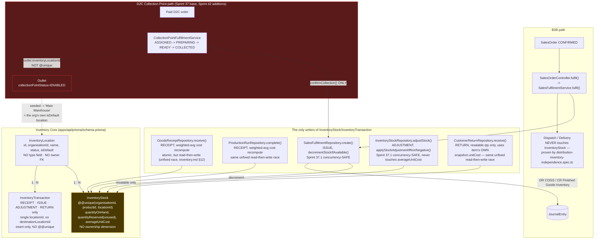
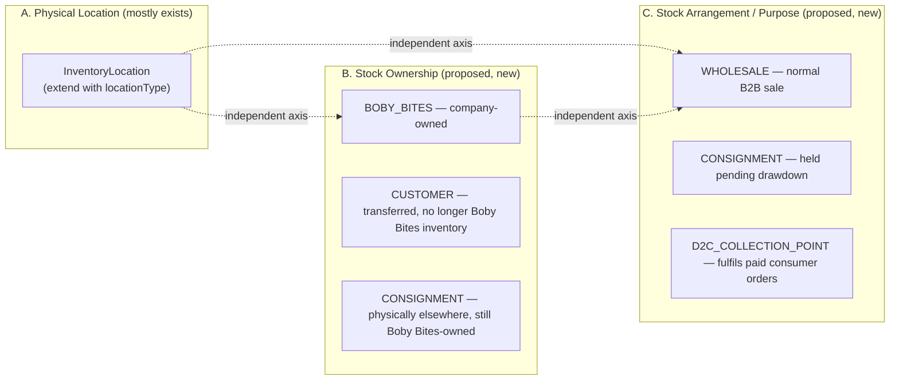

# Customer-Location Inventory Architecture Audit & Phase 2 Implementation Proposal

**Status:** Audit and design proposal, as originally written below — nothing in
this document's original findings or recommendations has been rewritten.
**Phase 2A (§11's first phase) has since been implemented** — see
[`docs/sprint-customer-location-inventory-phase-2a-completion-report.md`](sprint-customer-location-inventory-phase-2a-completion-report.md)
for exactly what was built and two verified, deliberate refinements to this
document's own §7 proposal, made during implementation after re-reading the
brief's own stricter design guidance:

1. **`InventoryLocation.outletId`, not `.customerId`** — §7's table proposed
   `customerId` as a candidate; the Phase 2A brief itself pointed out that linking
   to the more precise `Outlet` (rather than the broader `Customer`, which may
   have many outlets) avoids ambiguity and duplication. Implemented as `outletId`;
   the owning `Customer` remains one join away, never duplicated.
2. **`StockOwnership` simplified to two values, not three** — §5.1's own table
   used `CONSIGNMENT` as both an ownership value and an arrangement value, which
   is redundant: consignment stock remains `ORGANISATION`-owned (per this
   document's own §3.3 phrasing, "ownership remains with the supplying
   organisation") — `CONSIGNMENT` is correctly an _arrangement_, not a third kind
   of owner. Implemented as `StockOwnership { ORGANISATION, CUSTOMER }` (two
   values) and `StockArrangement { WHOLESALE, CONSIGNMENT, D2C_COLLECTION_POINT }`
   (three values) — cleaner and more orthogonal than this document's original
   draft table. Also renamed `BOBY_BITES` → `ORGANISATION` throughout, to avoid
   hardcoding the first tenant's name into a reusable platform enum (Engineering
   Handbook Principle 2).

**Phase 2B (§11's second phase) has since been implemented** — see
[`docs/sprint-customer-location-inventory-phase-2b-completion-report.md`](sprint-customer-location-inventory-phase-2b-completion-report.md)
for exactly what was built and the design refinements made during
implementation:

3. **The transfer's two `InventoryTransaction` legs use two distinct
   `referenceType` strings** (`'TransferOut'`/`'TransferIn'`), not the single
   shared string §13.5 of the Phase 2A completion report's own doc comment
   anticipated — mirroring the established `RETURN` convention
   (`'CustomerReturn'`/`'SupplierReturn'`) once the model was actually built,
   which turned out to fit better than a shared string.
4. **The §2.1 "collapse into one balance" risk is resolved at the application
   layer, not by widening `InventoryStock`'s unique key.** This document's own
   §7 table left the exact mechanism open; Phase 2B resolved it by rejecting
   (not merging) any transfer or opening-stock write that would place a
   different `ownership`/`arrangement` at a `(location, product)` pair that
   already holds stock under a different one — enforced atomically inside the
   same `INSERT ... ON CONFLICT ... DO UPDATE ... WHERE` that performs the
   increment. `InventoryStock.@@unique([organisationId, productId, locationId])`
   is unchanged.
5. **The increment-side weighted-average-cost concurrency gap (§6, "the one
   documented gap this audit does NOT recommend silently carrying forward") is
   now fixed — but only for the new Transfer destination-increment path**, via
   the same atomic `INSERT ... ON CONFLICT ... DO UPDATE` statement just
   mentioned. The three pre-existing call sites
   (`GoodsReceiptRepository`/`ProductionRunRepository`/
   `CustomerReturnRepository`) were deliberately left unmodified — retrofitting
   them was judged outside Phase 2B's "smallest safe" scope; see the completion
   report's "Known Limitations."

Phase 2C (§11) remains entirely unimplemented, exactly as this document's
original Known-Limitations framing anticipated. The shared-`InventoryStock`-row
risk between B2B and D2C Collection Point fulfilment (§3.3, §9) and the missing
Collection Point reversal path (§3.2 item 7) both remain fully open — neither
was in Phase 2B's scope, and Phase 2B's own regression tests confirm neither
seeded Collection Point outlet's `Outlet.inventoryLocationId` changed.

**Scope:** Requested as the pre-Phase-2 investigation into whether, and how,
Zentuva can track stock at every registered customer outlet (including Collection
Points) while keeping physical location, stock ownership, and commercial
arrangement as three independent, never-conflated dimensions. Builds directly on
the inventory findings already recorded in
[`docs/customer-account-inventory-audit.md`](customer-account-inventory-audit.md)
§3.3/§3.4, re-verified here against the current code rather than re-quoted.

**Method:** Direct inspection of `apps/api/prisma/schema.prisma`, the Inventory,
Sales, Distribution, and D2C Collection Point repositories/services/controllers,
existing integration/concurrency tests, and `docs/domains/*.md`. Every claim below
cites an exact file and, where practical, a line number or method name. Verified
facts are stated as fact; anything not independently confirmed is explicitly
flagged as unverified rather than assumed.

---

## 1. Executive Summary

Zentuva's existing Inventory domain is a deliberately minimal, single-dimension
ledger: a named `InventoryLocation` (no type, no owner), an `InventoryStock`
balance per `(organisation, product, location)`, and an insert-only
`InventoryTransaction` log with exactly four event types (`RECEIPT`/`ISSUE`/
`ADJUSTMENT`/`RETURN`). It has **no concept of stock ownership, no concept of a
commercial arrangement, and no transfer operation** — moving stock between two
locations today means two independent, unlinked `ADJUSTMENT` rows, not an atomic
transfer.

**The central, confirmed finding of this audit**: the Sprint 37/42 D2C Collection
Point fulfilment flow deducts inventory by calling the exact same
`SalesFulfilmentService.fulfil()` that B2B warehouse fulfilment calls, against
`Outlet.inventoryLocationId` — a field that is **not unique** and, in the real
seeded data, is set to the **same "Main Warehouse" `InventoryLocation`** that B2B
fulfilment uses by default when no location is specified. There is no reservation,
partition, or ownership marker separating "this unit is Collection Point stock"
from "this unit is ordinary warehouse stock" — they are, today, literally the same
database row. **Does Sprint 42 deduct from the correct physical inventory
location? It deducts from _a_ real, correctly-identified `InventoryLocation` — but
that location is not distinguished in any way from a shared warehouse pool, so the
system cannot today prove that a Collection Point's displayed stock reflects goods
actually at that outlet's shelf rather than goods still sitting in the factory
warehouse that merely share the same database row.** This is the single most
important gap this audit identifies, and it is classified as a genuine
architecture gap to be closed in Phase 2 — not a bug in the Sprint 37/42 code,
which did exactly what it was asked to do (reuse the existing fulfilment engine,
introduce no new stock ledger) and documented the sharing explicitly at the time.

A second, equally material and previously undocumented finding: **a Collection
Point order, once collected, has no reversal, cancellation, or return path
anywhere in the codebase.** `SalesOrderService.cancel()` blocks cancellation once
an order is `FULFILLED`/`PARTIALLY_FULFILLED` (which `confirmCollection` always
causes), and `CustomerReturnService.request()` explicitly rejects any order with
`customerId === null` — every D2C order — with a comment claiming "no D2C
fulfilment exists yet," which has not been true since Sprint 37. A damaged,
mis-collected, or disputed Collection Point order cannot be corrected through any
existing workflow today.

The good news: the existing architecture is a genuinely sound foundation to extend.
`InventoryStock`'s composite-unique key, the Sprint 37.1 concurrency-safe decrement
primitive, the moving-weighted-average costing engine, and the
`Outlet.inventoryLocationId` bridge are all real, tested, production-quality
pieces. Phase 2's job is to add exactly two new dimensions — a location **type**
and a stock **ownership/arrangement** reference — without touching any of this
working machinery, and to give Collection Points (and, eventually, every
registered outlet) their own distinguishable location.

---

## 2. Existing Architecture Map



**Key architectural facts, each independently verified:**

- `InventoryLocation` (`schema.prisma:1008-1053`): `id, organisationId, name,
status (ACTIVE|INACTIVE), isDefault, createdById, updatedById, timestamps`. No
  `@@unique` at all. **No type/category field exists anywhere on this model.**
- `InventoryStock` (`schema.prisma:1276-1314`): `@@unique([organisationId,
productId, locationId])` — the one hard uniqueness boundary in the whole domain.
  `quantityReserved` exists but is never written anywhere (`docs/domains/
inventory.md` §11: "always `0` today").
- `InventoryTransaction` (`schema.prisma:1351-1394`): `InventoryTransactionType`
  is exactly `RECEIPT | ISSUE | ADJUSTMENT | RETURN` (`schema.prisma:1323-1332`)
  — **no `TRANSFER` value exists.** No `destinationLocationId`. No `@@unique`
  constraint of any kind — a pure insert-only ledger.
- `Outlet.inventoryLocationId` (`schema.prisma:1958-1982`): nullable, **not
  `@unique`**, `onDelete: Restrict`. Doc comment, verbatim: _"several Collection
  Points may legitimately draw from one shared warehouse location, the same
  many-outlets-to-one-location reality `SalesFulfilment.locationId` already
  assumes for B2B."_ Reverse relation `InventoryLocation.outlets Outlet[]`
  confirms the cardinality is genuinely one-to-many.
- Seed data (`apps/api/prisma/seed.ts:479-511, 2105-2123`): exactly **two**
  `InventoryLocation` rows exist ("Main Warehouse", `isDefault: true`; "Cold
  Storage", `isDefault: false`), and exactly **one** seeded Collection Point
  (`OUT-000003`, "Bodija Supermart — Bodija Branch"), whose `inventoryLocationId`
  is set to **"Main Warehouse"** — the organisation's own default location, the
  same one `SalesFulfilmentService.getAvailability()`/`fulfil()` fall back to via
  `InventoryLocationRepository.getOrCreateDefault()` whenever a B2B caller omits
  `locationId` (`sales-fulfilment.service.ts:47-55`). _(Correction to a possibly
  misleading phrase elsewhere: Sprint 42's own completion report, §18, refers
  informally to "the Bodija Branch inventory location" — "Bodija Branch" is the
  **outlet's** name, not an `InventoryLocation` name. The actual
  `InventoryLocation` involved is "Main Warehouse," confirmed directly from
  `seed.ts`. This is loose prose in that report, not a separate dedicated
  location — and it is exactly the kind of imprecision this audit was asked to
  cut through rather than repeat.)_
- `outlet.service.ts`'s `assertValidInventoryLocation()` (`:284-301`) only checks
  that the target `InventoryLocation` exists and belongs to the caller's own
  organisation — **no check against the location's `status`, and no check that
  another outlet doesn't already reference it.** Arbitrary reuse across outlets is
  allowed by design, not oversight.

---

## 3. Sprint 42 Collection Point Inventory-Deduction Trace

### 3.1 What Sprint 42 actually is (verified, not assumed)

The brief's "mandatory Sprint 42 investigation" is answered precisely as follows.
`docs/sprint-42-completion-report.md` is titled **"D2C Collection Point Fulfilment
& Order Completion."** Reading it alongside the live code's own doc-comment sprint
attributions (`collection-point-fulfillment.service.ts`), the **base
assign/prepare/ready/collect state machine and the inventory-deducting call to
`SalesFulfilmentService.fulfil()` are tagged Sprint 37**, not Sprint 42. **Sprint
42's actual, confirmed additions** are: (1) consumer WhatsApp notifications on
Ready/Collected (`notifyReady`/`notifyCollected`, best-effort, errors swallowed),
(2) an `assertPaymentStillValid()` guard that blocks _forward_ progress if the
order's payment has since gone `FAILED`/`VOIDED`/`CLOSED` (it does **not** reverse
anything already deducted), and (3) four new real-Postgres concurrency tests for
the status-transition primitive. Sprint 42's own §15 explicitly audited the
accounting question and concluded "no new financial event is required," since
fulfilment's existing Sprint 10 COGS posting already fires unchanged. **No
migration was added in Sprint 42** — confirmed by the migrations list in §2 above
stopping at `sprint37_collection_point_fulfillment` (2026-10-01).

### 3.2 The complete call chain (verified against current code)

1. **Eligibility** — `CollectionPointFulfillmentService.isEligible()`
   (`:649-659`): `outlet.status === 'ACTIVE' && outlet.collectionPointStatus ===
'ENABLED' && !!outlet.inventoryLocationId`. `findEligibleOutlet()` additionally
   filters by territory match.
2. **Assignment** — `autoAssign()` (`:77-121`, called from `D2CPaymentService
.handleProviderCallback()` after payment verification) or `assignManually()`
   (`:128-184`, admin fallback).
3. **State transitions** — `startPreparing()` (`ASSIGNED → PREPARING`),
   `markReadyForCollection()` (`PREPARING → READY_FOR_COLLECTION`, runs the
   non-authoritative `getAvailability()` as a UX-only pre-check), `confirmCollection()`
   (`READY_FOR_COLLECTION → COLLECTED`) — **the only transition that deducts
   inventory.**
4. **The exact deduction call** (`confirmCollection()`, `:344-357`):
   ```ts
   await this.salesFulfilmentService.fulfil(
     organisationId,
     cpf.salesOrderId,
     {
       locationId: outlet.inventoryLocationId,
       fulfilmentDate: new Date(),
       notes: 'D2C Collection Point fulfillment',
       idempotencyKey: `collection-point-fulfillment:${cpf.id}`,
       items,
     },
     actorUserId,
   );
   ```
   `outlet.inventoryLocationId` is read fresh from a fetch at `:327-332` —
   confirmed to be the real, current value, not a stale snapshot.
5. **Transaction boundary — NOT one atomic unit.** `confirmCollection()` first
   commits the status flip (`updateStatus(... COLLECTED)`) via its own
   `updateMany`, **then separately** calls `fulfil()`, which opens its own,
   independent `$transaction` inside `SalesFulfilmentRepository.create()`. If
   `fulfil()` throws (e.g. no open accounting period, genuine stock shortfall),
   `confirmCollection()`'s `catch` block **manually** reverts the status back to
   `READY_FOR_COLLECTION` (`:358-377`) — a deliberate compensating-action design,
   not a single cross-table database transaction. This is a narrower window than
   a true atomicity gap (the compensation is synchronous, in the same request),
   but it is not the same guarantee as one `$transaction` spanning both writes.
6. **Idempotency — two independent layers**: `CollectionPointFulfillment
.salesOrderId` is `@unique` (`schema.prisma:2393`, one CPF row per order,
   ever); `SalesFulfilment` has `@@unique([salesOrderId, idempotencyKey])`
   (`:2291`), checked inside `SalesFulfilmentRepository.create()`'s own
   transaction using the deterministic key `collection-point-fulfillment:${cpf.id}`.
   A retried `confirmCollection` call that already lost the status-flip race
   matches zero rows in `updateStatus` and returns the existing result **without
   ever calling `fulfil()` a second time.**
7. **Reversal/cancellation — verified absent.** Exhaustive grep of
   `collection-point-fulfillment.service.ts` for cancel/reverse/restock/refund
   returns zero matches beyond the one comment citing the brief section number.
   `SalesOrderService.cancel()` (`sales-order.service.ts:284-308`) explicitly
   rejects cancellation once `FULFILLED`/`PARTIALLY_FULFILLED` — the status
   `fulfil()` always sets. `CustomerReturnService.request()`
   (`:88-95`) explicitly rejects any order with `customerId === null` (every D2C
   order) with the comment _"no D2C fulfilment exists yet"_ — stale since Sprint 37. **Confirmed: there is no code path anywhere that restores inventory, or
   permits any correction, for a Collection-Point-deducted order.**
8. **GL postings** — the one and only journal entry on this entire path is
   `SalesFulfilmentRepository.create()`'s existing `DR COGS / CR Finished Goods
Inventory` (`:362-383`), sourced from `InventoryStock.averageUnitCost` read at
   the moment of consumption. **Sales Revenue and Accounts Receivable are never
   posted anywhere in the D2C flow** — confirmed both by `d2c-payment-independence
.spec.ts`'s structural guard (asserts no `postSystemJournalEntry` import in
   the D2C payment path) and by direct inspection of `PaymentService
.createPendingForConsumer()`/`.applyProviderCallback()`, neither of which
   calls it.

### 3.3 Shared-location confirmation

Confirmed by three independent pieces of evidence, not inference: (a) the schema
doc comment on `Outlet.inventoryLocationId` states the sharing is deliberate; (b)
`CollectionPointFulfillmentService` contains no reservation/partition logic
scoped to D2C-only stock; (c) the seeded Collection Point's `inventoryLocationId`
is literally the organisation's own default warehouse location. **The same
`InventoryStock` row — same `(organisationId, productId, locationId)` — can be,
and in the current seeded configuration is, consumed by both a B2B
`SalesFulfilmentService.fulfil()` call and a D2C `confirmCollection()` call, with
zero partition or reservation mechanism preventing it.**

### 3.4 Explicit answer to the mandatory question

> **Does Sprint 42 deduct from the correct physical inventory location?**

It deducts from the specific `InventoryLocation` row that `Outlet
.inventoryLocationId` names — in that narrow sense, yes, the deduction target is
correctly resolved and not arbitrary. **But the system cannot today prove that
`InventoryLocation` row represents stock physically present at the Collection
Point's own shelf**, because the same row may simultaneously represent warehouse
stock that has never left the factory. This is classified as a genuine
**integration gap**, per the brief's own instruction, to be addressed by Phase 2's
proposed location-type/ownership model (§5, §7) — not something this audit
changes.

---

## 4. Current Movement Matrix (verified, not aspirational)

| Event                              | Source location                                                                                                    | Destination location                                 | Ownership effect                                                                                                                                                                                                                   | Stock-ledger effect                                                                                                                                              | Accounting effect                                                                                                                                                                                                                                       |
| ---------------------------------- | ------------------------------------------------------------------------------------------------------------------ | ---------------------------------------------------- | ---------------------------------------------------------------------------------------------------------------------------------------------------------------------------------------------------------------------------------- | ---------------------------------------------------------------------------------------------------------------------------------------------------------------- | ------------------------------------------------------------------------------------------------------------------------------------------------------------------------------------------------------------------------------------------------------- |
| Production receipt                 | Production (no location)                                                                                           | The `InventoryLocation` the Production Order names   | None modelled — stock simply exists at Boby Bites                                                                                                                                                                                  | `RECEIPT`, weighted-avg cost recompute (`production-run.repository.ts:180-233`) — **unfixed read-then-write race**, per `inventory.md` §12                       | `DR WIP-clearing / CR ...` posted in the same transaction (`:242-277`); no COGS yet                                                                                                                                                                     |
| Warehouse-to-outlet dispatch       | —                                                                                                                  | —                                                    | **Unsupported.** No stock-moving event exists at Dispatch at all                                                                                                                                                                   | **None** — `DispatchRepository` structurally proven never to touch `InventoryStock`/`InventoryTransaction` (`distribution-inventory-independence.spec.ts:17-42`) | None                                                                                                                                                                                                                                                    |
| Outlet receipt confirmation        | —                                                                                                                  | —                                                    | **Unsupported** — no such concept exists                                                                                                                                                                                           | None                                                                                                                                                             | None                                                                                                                                                                                                                                                    |
| B2B sale (fulfilment)              | The `InventoryLocation` named by `SalesFulfilmentService.fulfil()`'s `locationId` (client-supplied or org default) | Implicit "customer" — **no record created anywhere** | **Purely implicit.** No field on `SalesOrder`/`Invoice`/`SalesFulfilment` ever records "customer now owns this stock." Ownership transfer is inferred only from the fact the ledger row was decremented                            | `ISSUE`, Sprint-37.1-safe atomic conditional decrement (`decrementStockIfAvailable`)                                                                             | `DR COGS / CR Finished Goods Inventory`, sourced from `InventoryStock.averageUnitCost` at consumption time (`sales-fulfilment.repository.ts:270-383`)                                                                                                   |
| D2C Collection Point replenishment | —                                                                                                                  | —                                                    | **Unsupported** — a Collection Point's stock is replenished only by ordinary Goods Receipt/Production Completion writing directly to the shared `InventoryLocation`, never a dedicated "send stock to this Collection Point" event | None distinct from Goods Receipt/Production (§above)                                                                                                             | None distinct                                                                                                                                                                                                                                           |
| D2C order fulfilment (Collection)  | `Outlet.inventoryLocationId`                                                                                       | Consumer (implicit, no record)                       | Same as B2B — purely implicit, no record                                                                                                                                                                                           | `ISSUE`, same `decrementStockIfAvailable` call, via `confirmCollection()` → `fulfil()`                                                                           | `DR COGS / CR Finished Goods Inventory` only — **no Sales Revenue, no AR, ever, for D2C** (§3.2 item 8)                                                                                                                                                 |
| Customer return                    | The return's own `locationId` (chosen at return time, independent of original fulfilment location)                 | Same location, resalable quantity only               | Reverses the B2B ownership-transfer _implication_ for resalable qty only; damaged/quarantine/scrap quantities are never restocked and never reverse COGS                                                                           | `RETURN`, weighted-avg recompute using the item's **own snapshot `unitCost`** (not current live average) — same unfixed read-then-write race class               | `DR Finished Goods Inventory / CR COGS` for resalable qty only (`customer-return.repository.ts:557-570`), plus a Credit Note (requires an eligible `Invoice` — **D2C orders have none, and are rejected upfront by `CustomerReturnService.request()`**) |
| Consignment drawdown               | —                                                                                                                  | —                                                    | **Unsupported.** No consignment concept exists anywhere in schema, code, or current docs                                                                                                                                           | N/A                                                                                                                                                              | N/A                                                                                                                                                                                                                                                     |
| Damage/write-off                   | Current location                                                                                                   | Loss (conceptual only — no distinct "loss" location) | Reduces `quantityOnHand`; no ownership concept to adjust                                                                                                                                                                           | `ADJUSTMENT`, reason `DAMAGE`/`SPOILAGE`/`LOSS`, Sprint-37.1-safe atomic (`applyStockAdjustmentIfNonNegative`), **never touches `averageUnitCost`**              | **None** — confirmed no journal entry is posted for any `ADJUSTMENT` reason; it is a pure quantity change                                                                                                                                               |
| Physical stock adjustment          | Current location                                                                                                   | Same location                                        | Unchanged                                                                                                                                                                                                                          | `ADJUSTMENT`, reason `PHYSICAL_COUNT`/`FOUND_STOCK`/`DATA_CORRECTION`/`OTHER`                                                                                    | None (same as above)                                                                                                                                                                                                                                    |

**Exact ownership-transfer point for a B2B sale, verified**: there is none. Revenue
is recognised at `Invoice.issue()` (a separate, manual Finance action, unrelated to
inventory), while inventory is decremented at `SalesFulfilmentService.fulfil()` —
two genuinely independent events, already correctly decoupled by this codebase's
existing architecture (confirmed in the prior Phase 1 audit), but **neither one
ever writes an explicit "ownership transferred" record.** Goods simply vanish from
`InventoryStock` with no corresponding "customer now holds N units" row anywhere.
This is exactly the gap Phase 2 exists to close for stock that is meant to remain
_traceable_ after a sale (customer-held/consignment), while correctly leaving an
ordinary wholesale sale's goods untracked post-sale (the business has no interest
in a wholesaler's shelf once it's sold outright).

---

## 5. Location / Ownership / Arrangement Domain Model (proposed)

These three dimensions do not exist today in any form beyond physical location.
The proposal below is a **design**, not an implementation.



**A. Physical location** — `InventoryLocation` can represent every example in the
brief (factory warehouse, branch, registered outlet, Collection-Point-capable
outlet) **with one addition**: a `locationType` enum (`WAREHOUSE` default |
`CUSTOMER_LOCATION`). No new table. Every existing `InventoryLocation` row
defaults to `WAREHOUSE`, preserving current behaviour exactly.

**B. Stock ownership** — a **new, small, separate table**
(`InventoryStockOwnership` or similar — exact naming a Phase 2A implementation
detail, not this audit's job to finalise) recording, per `InventoryStock` row (or
per movement — see §7), which of `BOBY_BITES`/`CUSTOMER`/`CONSIGNMENT` applies.
**Not** a field on `InventoryLocation` itself, because ownership can change at the
_same_ physical location over time (a consignment drawdown converts
`CONSIGNMENT` → sold without the goods moving anywhere) — conflating the two
dimensions onto one row would make that transition inexpressible without lying
about physical location.

**C. Stock arrangement/purpose** — best modelled as an attribute of the
**movement event** (the `InventoryTransaction`/its referencing business record),
not a standing property of the location or the stock balance. A single
`InventoryLocation` of type `CUSTOMER_LOCATION` can legitimately hold wholesale
(now customer-owned, arguably shouldn't even be tracked — see §7's MVP scoping),
consignment (Boby-Bites-owned), and D2C Collection Point stock (Boby-Bites-owned,
earmarked for consumer fulfilment) **simultaneously**, for different SKUs or
different batches of the same SKU. Baking "arrangement" into the location itself
would make that impossible to represent.

### 5.1 Valid combinations and their effects

| Location type                                  | Ownership                        | Arrangement            | Valid?                                                                   | Stock availability                                                            | Valuation                                                    | Accounting                                                                                                    |
| ---------------------------------------------- | -------------------------------- | ---------------------- | ------------------------------------------------------------------------ | ----------------------------------------------------------------------------- | ------------------------------------------------------------ | ------------------------------------------------------------------------------------------------------------- |
| `WAREHOUSE`                                    | `BOBY_BITES`                     | `WHOLESALE`            | Yes (today's only real case)                                             | Available for any fulfilment                                                  | Included in Boby Bites inventory value                       | COGS at fulfilment, as today                                                                                  |
| `CUSTOMER_LOCATION`                            | `CUSTOMER`                       | `WHOLESALE`            | Yes — the "customer-owned, physically traceable" case the brief names    | **Not** available for Boby Bites fulfilment from this row; informational only | **Excluded** from Boby Bites inventory valuation (§9)        | None — the sale already recognised revenue/COGS at the original fulfilment; this is post-sale visibility only |
| `CUSTOMER_LOCATION`                            | `CONSIGNMENT` (Boby-Bites-owned) | `CONSIGNMENT`          | Yes                                                                      | Available for drawdown only, not ordinary fulfilment                          | **Included** in Boby Bites inventory valuation (still owned) | COGS deferred until drawdown (Phase 3 territory — see §9)                                                     |
| `CUSTOMER_LOCATION` (Collection-Point-capable) | `CONSIGNMENT`                    | `D2C_COLLECTION_POINT` | Yes — this is what Sprint 37/42 should have been, architecturally        | Available for D2C fulfilment only, reserved against double-use by B2B         | Included in valuation                                        | COGS at collection (unchanged from today)                                                                     |
| `WAREHOUSE`                                    | `CUSTOMER`                       | anything               | **Invalid** — a warehouse cannot hold customer-owned stock by definition | N/A                                                                           | N/A                                                          | N/A — reject at write time                                                                                    |

A Collection Point **must not automatically imply consignment or Boby Bites
ownership** (brief's own instruction) — the ownership/arrangement fields are
independently set per-location-assignment, not inferred from
`collectionPointStatus` alone. The _recommended_ default for a newly-enabled
Collection Point is `CONSIGNMENT`/`D2C_COLLECTION_POINT` (§13), but that is a
business decision to confirm, not something the architecture should hardcode.

---

## 6. Inventory Data Integrity Risk Register

| Risk                                                                                       | Current architecture                                                                                                                                                           | Verdict                                                                                                                                                                                                                                                                                                          |
| ------------------------------------------------------------------------------------------ | ------------------------------------------------------------------------------------------------------------------------------------------------------------------------------ | ---------------------------------------------------------------------------------------------------------------------------------------------------------------------------------------------------------------------------------------------------------------------------------------------------------------- |
| Dispatch deducts warehouse stock but fails to create destination stock                     | Dispatch never touches inventory at all today (§4)                                                                                                                             | **Not applicable today** — becomes a real risk only once Phase 2B adds outlet receipt as a stock-moving event; must be designed atomically from day one (§7)                                                                                                                                                     |
| A retry creates duplicate destination stock                                                | `SalesFulfilment`/`CustomerReturn` both have `@@unique([..., idempotencyKey])`; `InventoryTransaction` itself has no unique constraint                                         | **Prevented** for the two existing write paths via their owning record's idempotency key; a bare `InventoryTransaction` insert has no independent guard, but nothing writes one without going through an idempotency-guarded owner today                                                                         |
| A fulfilment consumes the same stock twice                                                 | `decrementStockIfAvailable` — Postgres row-lock-on-UPDATE via conditional `updateMany`                                                                                         | **Prevented** (Sprint 37.1, live-tested — see `inventory-stock-concurrency.integration.spec.ts`)                                                                                                                                                                                                                 |
| Stock deducted from warehouse instead of Collection Point                                  | `confirmCollection()` always reads `outlet.inventoryLocationId` fresh                                                                                                          | **Prevented in the narrow sense** (correct row targeted) — but see the next risk                                                                                                                                                                                                                                 |
| The same stock is represented at both source and destination                               | Collection Point and warehouse can share the identical `InventoryStock` row (§3.3)                                                                                             | **Not prevented — confirmed live risk today**, not hypothetical. This is the audit's central finding.                                                                                                                                                                                                            |
| Outlet return creates stock with no corresponding original movement                        | `CustomerReturn` requires `salesOrderId` + validates eligible items against that order                                                                                         | **Prevented** for the existing B2B return path; **not applicable** to D2C (returns are blocked entirely for D2C orders — see below, a different kind of gap)                                                                                                                                                     |
| Damaged/expired quantity remains available for fulfilment                                  | `ADJUSTMENT` reduces `quantityOnHand` directly; no quarantine/hold state exists (`inventory.md` §11)                                                                           | **Left possible for "available but shouldn't be"** scenarios with a lag between damage discovery and adjustment entry — inherent to any system without real-time quarantine, not unique to this one                                                                                                              |
| A transfer crosses organisation/tenant boundaries                                          | No transfer mechanism exists at all (§2)                                                                                                                                       | **Not applicable today**; must be designed with `organisationId` matched on both legs in Phase 2A (§7)                                                                                                                                                                                                           |
| Concurrent orders oversell the same SKU at a Collection Point                              | Same `decrementStockIfAvailable` primitive B2B uses                                                                                                                            | **Prevented** at the row level — but this actually makes the sharing problem _worse_, not better: a B2B sale and a D2C sale racing for the same row are both correctly prevented from overselling the _row_, while nothing prevents the row itself from representing the wrong physical stock in the first place |
| A location is disabled/loses Collection Point capability while stock or open orders remain | `assertValidInventoryLocation()` has no status check (§2); nothing blocks disabling `collectionPointStatus` while a CPF is `ASSIGNED`/`PREPARING`/`READY_FOR_COLLECTION`       | **Not prevented** — confirmed gap, worth a guard in Phase 2C                                                                                                                                                                                                                                                     |
| A reversal restores stock to the wrong location                                            | No reversal path exists for D2C at all (§3.2 item 7); B2B return reverses to the return's own chosen `locationId`, which the operator could mis-select                         | **Partially prevented** (B2B return requires an explicit location choice, auditable); **not applicable** to D2C since no reversal exists                                                                                                                                                                         |
| An inventory movement changes financial valuation/accounting incorrectly                   | Weighted-average recompute is atomic for decrements (ISSUE), **not atomic for increments** (`RECEIPT`/`RETURN`) — confirmed, self-disclosed open finding in `inventory.md` §12 | **Left possible** under genuine concurrent Goods Receipts/Production Completions/Returns for the same `(org, product, location)` — a real, if narrow, residual risk inherited unchanged by Phase 2, worth flagging as a Phase 2A prerequisite-or-explicitly-deferred decision (§9)                               |
| Customer-owned stock included in Boby Bites inventory valuation                            | `InventoryValuationService` sums every `InventoryStock` row for the org with no ownership filter (no ownership field exists to filter on)                                      | **Currently not possible to even represent**, so not currently happening — but this is exactly the gap Phase 2A's ownership field closes, and valuation must be updated in lockstep (§7, §9)                                                                                                                     |
| Consignment stock omitted from or double-counted in the ownership view                     | No consignment concept exists today                                                                                                                                            | **Not applicable today**; must be designed correctly from the first Phase 2A release, not retrofitted                                                                                                                                                                                                            |

**Recommended safeguards, reusing existing architecture wherever possible:**

- **Atomic transactions**: continue the existing `$transaction` convention for every new write path (location-type-aware fulfilment, outlet receipt, transfer).
- **Idempotency keys**: extend the existing `@@unique([..., idempotencyKey])` pattern to any new "outlet receipt confirmation" or "transfer" record — do not invent a different mechanism.
- **Concurrency-safe decrement**: reuse `decrementStockIfAvailable`/`applyStockAdjustmentIfNonNegative` verbatim for any new consuming event (e.g. a D2C-specific reservation) — do not write a third concurrency primitive.
- **Append-only ledger**: `InventoryTransaction` already is one; a `TRANSFER` type should be two paired rows (source `ISSUE`-like, destination `RECEIPT`-like) referencing each other via `referenceType`/`referenceId`, matching the existing polymorphic-reference convention already used throughout this table — not a new pairing FK.
- **Server-authoritative availability**: continue to never trust a client-supplied quantity; `getAvailability()`'s existing non-authoritative-pre-check-then-authoritative-decrement pattern is correct and should be reused for any new reservation concept.
- **Reconciliation/exception reporting**: no such capability exists today for inventory (only `InventoryValuationService`, a point-in-time sum) — a genuinely new, small addition is warranted (§10), reusing the Reporting module's existing composition pattern (established in Phase 1).
- **The one documented gap this audit does NOT recommend silently carrying forward**: the increment-with-cost-recompute race (`GoodsReceiptRepository`/`ProductionRunRepository`/`CustomerReturnRepository`). This is pre-existing, not introduced by Phase 2, but Phase 2A should decide explicitly whether to fix it (apply the same conditional-`updateMany`-based pattern, generalised for a cost-weighted increment) before or alongside introducing ownership tracking, since ownership-aware stock makes correctness here more consequential, not less. See §9.

---

## 7. Recommended Minimal Schema and Service Design (Phase 2A/2B candidate)

Every item below is a **candidate**, evaluated against "does the existing
architecture already cover this." Items marked _Deferred_ are explicitly not
proposed for the MVP.

| Element                                                                                                                                                                                         | Purpose                                                                                                                   | Exists today?                                                                                                                                                                                         | Why extend                                                                                                                                                                       | Tenant scoping                                                                                   | API/UI effect                                                                                                          | Migration/backfill                                                                                                                                                                                                                                                                          | MVP or deferred                                                                                                                                                            |
| ----------------------------------------------------------------------------------------------------------------------------------------------------------------------------------------------- | ------------------------------------------------------------------------------------------------------------------------- | ----------------------------------------------------------------------------------------------------------------------------------------------------------------------------------------------------- | -------------------------------------------------------------------------------------------------------------------------------------------------------------------------------- | ------------------------------------------------------------------------------------------------ | ---------------------------------------------------------------------------------------------------------------------- | ------------------------------------------------------------------------------------------------------------------------------------------------------------------------------------------------------------------------------------------------------------------------------------------- | -------------------------------------------------------------------------------------------------------------------------------------------------------------------------- |
| `InventoryLocation.locationType` (`WAREHOUSE` \| `CUSTOMER_LOCATION`)                                                                                                                           | Distinguish a company warehouse from a location physically at a customer/outlet                                           | No                                                                                                                                                                                                    | Smallest possible addition; everything else about `InventoryLocation` already works                                                                                              | Inherits existing `organisationId` scoping                                                       | Additive — every existing row defaults to `WAREHOUSE`; no existing query breaks                                        | Default-backfill, zero ambiguity (every current row IS a warehouse by current usage)                                                                                                                                                                                                        | **MVP**                                                                                                                                                                    |
| `InventoryLocation.customerId` (nullable FK → `Customer`)                                                                                                                                       | Know which customer's outlet a `CUSTOMER_LOCATION` belongs to, for reporting/access-control, without duplicating `Outlet` | No                                                                                                                                                                                                    | Simpler than relying solely on the reverse `Outlet.inventoryLocationId` path when a location needs to be queried "whose is this" without joining through Outlet                  | Same org as the referenced `Customer` (enforced at write time)                                   | Additive                                                                                                               | Backfillable only for locations already linked via `Outlet.inventoryLocationId` — see §8                                                                                                                                                                                                    | **MVP**                                                                                                                                                                    |
| New table: `InventoryStockOwnership` (or an ownership field set directly per-movement — see note below)                                                                                         | Record `BOBY_BITES` \| `CUSTOMER` \| `CONSIGNMENT` per stock position                                                     | No — no ownership concept exists anywhere                                                                                                                                                             | Required to satisfy the brief's core "do not count customer-owned goods as Boby Bites inventory" instruction                                                                     | Scoped by the same `(organisationId, productId, locationId)` its `InventoryStock` row belongs to | `InventoryValuationService` gains an ownership filter (additive — default query unchanged, new explicit filter opt-in) | No historical ownership data exists — every pre-Phase-2 `InventoryStock` row at a `WAREHOUSE`-type location defaults to `BOBY_BITES`/`WHOLESALE`; a `CUSTOMER_LOCATION`-type row (new as of Phase 2B) starts with NO assumed ownership — must be set explicitly at creation, never inferred | **MVP** (minimal version only — see note)                                                                                                                                  |
| `InventoryTransactionType.TRANSFER` (new enum value) + a `pairedTransactionId` self-reference on `InventoryTransaction`                                                                         | Represent an atomic move between two locations as one logical event instead of two unlinked `ADJUSTMENT` rows             | No                                                                                                                                                                                                    | Closes `inventory.md`'s own long-standing, self-documented "no atomic transfer" limitation; directly needed for "warehouse-to-outlet dispatch" (§4, currently unsupported)       | N/A — both legs already share `organisationId` by construction                                   | New `POST /inventory/transfers` endpoint (candidate name)                                                              | Pure addition — no backfill, since no transfer history exists to represent (every historical "move" was two independent `ADJUSTMENT` rows and should stay represented that way, not retroactively paired)                                                                                   | **MVP** for Phase 2B (outlet dispatch needs it); **not required** for 2A alone                                                                                             |
| `arrangement` as an attribute of the triggering business record (e.g. `SalesOrder.arrangementType`, or simply inferred from which service call wrote the transaction), NOT a new standing table | Represent `WHOLESALE` \| `CONSIGNMENT` \| `D2C_COLLECTION_POINT` per movement                                             | No                                                                                                                                                                                                    | Simpler than a new domain concept — every movement already has a `referenceType`/`referenceId` pointing at its owning record; arrangement can live there or be derivable from it | N/A                                                                                              | Reporting surfaces it by joining through the existing reference, not a new join target                                 | N/A                                                                                                                                                                                                                                                                                         | **MVP**                                                                                                                                                                    |
| A unique reference to the originating business transaction                                                                                                                                      | Trace any new movement back to its cause                                                                                  | **Already exists** — `InventoryTransaction.referenceType`/`referenceId`                                                                                                                               | No extension needed                                                                                                                                                              | Already correct                                                                                  | None                                                                                                                   | None                                                                                                                                                                                                                                                                                        | Already done                                                                                                                                                               |
| A traceable reversal relationship                                                                                                                                                               | Know that movement B undid movement A                                                                                     | **Partially exists** implicitly (a `RETURN` row references the original `CustomerReturn`, which references the original `SalesOrder`) — no explicit "this transaction reverses that transaction" link | A `TRANSFER`'s reversal (an outlet sending stock back) is a real new case worth an explicit `reversesTransactionId` nullable self-FK                                             | Same org by construction                                                                         | Candidate: surfaced in reconciliation reporting                                                                        | Additive                                                                                                                                                                                                                                                                                    | _Deferred to 2C if not needed sooner_                                                                                                                                      |
| Quantity reservation at a Collection Point                                                                                                                                                      | Prevent a B2B sale from draining stock a confirmed-but-not-yet-collected D2C order needs                                  | `quantityReserved` field **already exists** on `InventoryStock`, unused                                                                                                                               | Finally give it a real writer, scoped to D2C                                                                                                                                     | Same org                                                                                         | `getAvailability()` would need to subtract reservations                                                                | N/A — starts at 0 everywhere, matches current reality                                                                                                                                                                                                                                       | _Deferred to 2C_ — valuable but not required to fix the core shared-row gap, which is solved by giving Collection Points their own `CUSTOMER_LOCATION`-type location first |

**Note on the ownership table's minimal MVP shape**: rather than a full
"ownership ledger" tracking ownership-per-unit over time (overengineering for
Phase 2A), the smallest safe version is **one ownership/arrangement pair stored
directly on `InventoryStock`** (two new nullable-with-default columns:
`ownership` and `arrangement`), **not** a separate table — because, per §5's own
design reasoning, ownership is a property of the stock _position_
`(org, product, location)`, and Phase 2A does not yet need to track
ownership-per-batch within one location (that would require batch/lot tracking,
explicitly out of scope per `inventory.md`'s own existing limitations and this
audit's own non-implementation list, §13). If Phase 2B/2C later needs
mixed-ownership stock at the _same_ location for the _same_ product (e.g. some
consignment units and some wholesale-in-transit units at one outlet
simultaneously), that is the point to introduce a genuine ownership-ledger table
— **do not build it now on the hypothesis that it might be needed.**

**What this deliberately does NOT introduce**: a second balance authority.
`InventoryStock.quantityOnHand` remains the one and only quantity source of
truth everywhere, at every location, regardless of type or ownership — Phase 2
only adds _qualifiers_ to existing rows, never a parallel ledger. `ownership`/
`arrangement` are filters applied to the existing valuation/reporting queries,
not new quantity-tracking mechanisms.

---

## 8. Migration and Backward-Compatibility Strategy

1. **Mapping existing balances to the proposed model**: every existing
   `InventoryStock` row sits at a location that, after migration, defaults to
   `locationType: WAREHOUSE`, `ownership: BOBY_BITES`, `arrangement: WHOLESALE`.
   This is not a guess — it is **definitionally correct**, because under the
   current architecture every `InventoryLocation` is, by construction, something
   Boby Bites fully owns and operates (there is no other kind today).
2. **Can existing balances be reliably attributed to a physical location?**
   Yes, for location itself — `InventoryStock.locationId` already is that
   attribution, unambiguous and unchanged. What **cannot** be reliably attributed
   retroactively is _ownership history_ — whether stock currently at the
   Collection Point's shared "Main Warehouse" location represents warehouse stock
   or (hypothetically, if Phase 2B's own outlet receipt flow existed earlier)
   consignment stock already drawn down. Since no such flow has ever existed, this
   ambiguity is moot for historical data — **there is no customer/consignment
   stock to misattribute, because none has ever been separately tracked.**
3. **Unknown historical destination**: not applicable — no transfer event has
   ever been recorded (§4), so there is no historical destination to reconstruct
   or guess at.
4. **Avoiding fabricated customer-outlet stock from old sales orders**: **do
   not** attempt to backfill "Customer X has N units of Product Y at their
   outlet" by summing historical `SalesFulfilment` records. A completed B2B sale
   transfers ownership (§4) — the business has no ongoing interest in tracking
   what the customer did with goods they own outright, and fabricating a
   post-sale stock position from sales history would silently assert something
   never verified (the customer may have resold, consumed, lost, or returned it
   through an untracked channel). **No automatic backfill of customer-held
   quantities is proposed** — any customer-location opening balance must come
   from an explicit, labelled physical count or an explicit new consignment
   placement going forward (§13).
5. **Avoiding double-counting current warehouse stock**: trivially avoided —
   Phase 2A introduces no new `InventoryStock` rows, only new columns on
   existing rows. `InventoryValuationService`'s existing unfiltered sum
   continues to equal the same total it does today; the new `ownership`/
   `arrangement` columns are additive filters, never a second total.
6. **Additive and backward-compatible?** Yes, for 2A in full — every new column
   is nullable-with-safe-default, every existing query continues to work
   unmodified, and no existing API response shape changes unless a consumer
   explicitly opts into the new fields.
7. **Validating opening balances and movement totals before/after migration**:
   a pre-migration snapshot of `SELECT organisationId, SUM(quantityOnHand *
averageUnitCost) FROM inventory_stock GROUP BY organisationId` compared
   against the same query post-migration must be byte-identical (since no
   quantity/cost column changes) — a trivial, mechanical verification step.
8. **Rollback**: since the migration only adds nullable columns with defaults
   and no new tables with foreign-key dependents yet (Phase 2A), rollback is a
   plain `DROP COLUMN` — no data loss risk, because no data is transformed or
   deleted, only tagged. **Do not** combine this with any data-mutating backfill
   script in the same migration — keep schema-additive migrations and any future
   explicit-confirmation-driven data entry (opening counts, §13) as clearly
   separate operations.
9. **Records needing explicit reconciliation/user confirmation**: any
   `CUSTOMER_LOCATION`-type `InventoryLocation` created in Phase 2B/2C, and any
   non-zero opening balance assigned to it, must be explicitly labelled
   "unconfirmed — pending physical count" (a simple boolean or status field, not
   a new workflow engine) until a human confirms it. **No `CUSTOMER_LOCATION`
   stock position should ever be silently treated as equal in reliability to a
   warehouse position whose quantity is substantiated by Goods Receipt/
   Production/Fulfilment history.**

---

## 9. Inventory Costing and Accounting Boundaries

| Arrangement                                                                                                                                | Current treatment                                                                             | Phase 2 treatment (proposed)                                                                                                                                                                                                                                                                                                                                                                                                                          | New accounting entries invented?                                                                                                                                               |
| ------------------------------------------------------------------------------------------------------------------------------------------ | --------------------------------------------------------------------------------------------- | ----------------------------------------------------------------------------------------------------------------------------------------------------------------------------------------------------------------------------------------------------------------------------------------------------------------------------------------------------------------------------------------------------------------------------------------------------- | ------------------------------------------------------------------------------------------------------------------------------------------------------------------------------ |
| B2B wholesale, sold to customer                                                                                                            | COGS recognised at `SalesFulfilmentService.fulfil()`, `DR COGS / CR Finished Goods Inventory` | **Unchanged.** A `WAREHOUSE`→`CUSTOMER_LOCATION` transfer is explicitly **not** proposed for ordinary wholesale — the sale itself (fulfilment) remains the one and only event; no post-sale "customer stock" tracking is proposed for plain wholesale customers by default (§13 — opt-in only, informational)                                                                                                                                         | No                                                                                                                                                                             |
| Company-owned stock moved to another physical location (e.g. a second warehouse, or a `CUSTOMER_LOCATION` used as pure logistics overflow) | **Unsupported today** (no transfer mechanism)                                                 | A `TRANSFER` (§7) moves `quantityOnHand` and the weighted-average `averageUnitCost` basis from source to destination — **no valuation change**, since ownership and cost basis are both unchanged, only physical location                                                                                                                                                                                                                             | No — a transfer between two Boby-Bites-owned locations has zero P&L effect by definition, same as today's workaround (two `ADJUSTMENT` rows) already correctly has zero effect |
| Consignment stock, still Boby-Bites-owned, held at an outlet                                                                               | **Unsupported today**                                                                         | Remains in `InventoryValuationService`'s total (ownership = `BOBY_BITES`/`CONSIGNMENT`, still owned) with no COGS posted until drawdown. **Drawdown accounting (what entry fires when consignment stock is deemed sold) is explicitly NOT designed here** — it is Phase 3 territory per the brief's own instruction, and depends entirely on the unresolved commercial-settlement question `docs/customer-account-inventory-audit.md` already flagged | **No** — Phase 2 introduces the _tracking_ only; Phase 3 (a separate, explicit commercial decision) introduces the _posting_                                                   |
| D2C stock consumed at a Collection Point                                                                                                   | COGS at collection, unchanged since Sprint 10; no Revenue/AR ever posted (§3.2)               | **Unchanged COGS mechanics.** Phase 2C's only contribution is making the _location_ used for this COGS posting one that is verifiably dedicated to that Collection Point (ownership=`CONSIGNMENT`/`BOBY_BITES`, arrangement=`D2C_COLLECTION_POINT`), closing the shared-row risk (§3.3) — **not** changing what gets posted or when                                                                                                                   | No                                                                                                                                                                             |

**The one existing mismatch this audit is explicitly required to surface, not
invent a fix for**: D2C fulfilment reduces physical stock and correctly posts
COGS, **but D2C revenue is never recognised in the GL at all** (confirmed §3.2
item 8, and already flagged in the prior Phase 1-era audit,
`docs/customer-account-inventory-audit.md` §3.4). This means Finance's P&L today
silently **excludes all D2C/Collection-Point revenue** while correctly including
its cost — a real, material accounting gap, **predating this phase**, not caused
by it, and **not something Phase 2 is positioned to fix**, since fixing it
requires a business decision about how/when a D2C order is "invoiced"
(there is no `Invoice` for a consumer today, by design — Invoice requires
`customerId`). **This is recorded here as a prerequisite worth resolving before,
or in parallel with, Phase 2C**, not as something to silently carry forward
undisclosed. Per the brief's own instruction, Phase 2 cannot be considered
complete while this gap remains undisclosed — it is hereby disclosed, and
explicitly scoped **out** of Phase 2's own deliverables (§13).

**The increment-with-cost-recompute concurrency gap** (§6): a genuine, if narrow,
pre-existing risk. Recommendation: **treat closing it as a Phase 2A prerequisite**
rather than deferring it further, specifically because Phase 2A introduces
ownership-aware stock, and an un-atomic cost recompute racing against a
concurrent receipt becomes more consequential once that cost basis also
determines ownership-segmented valuation reporting (§6, §10). This is a
recommendation for the implementation phase, not something this audit builds.

---

## 10. Permission, UX, and Reporting Implications (proposed, not built)

Reuse, not reinvent — every pattern below already exists elsewhere in this
codebase:

- **Admin visibility across authorised locations**: reuse `inventory.stock.view`
  (already `SCOPABLE`) — no new permission needed for an admin to see every
  `CUSTOMER_LOCATION` alongside every `WAREHOUSE`.
- **Outlet-level stock visibility/adjustment**: a Collection Point operator
  already has `d2c.collection_point.view`/`.fulfil`, enforced via the existing
  **resource-ownership check inside the service** (the catalogue's own doc
  comment explicitly states `AccessScope.ASSIGNED_RECORDS` is "recorded, not
  enforced" at the scope-system level) — the correct pattern for "see only your
  assigned Collection Point's stock" is the same bespoke resource-ownership check
  `CollectionPointFulfillmentService` already uses, not a new generic scope.
  **Do not create a new broad permission granting unrestricted visibility.**
- **Field representative territory visibility**: reuse the existing
  `Employee.territoryId` + bespoke resource-ownership pattern Sprint 38 already
  established for `FieldD2COverviewService` — the same shape, applied to a new
  "my territory's outlet stock" query.
- **Stock transfer/adjustment approvals**: `inventory.adjustment.create` and
  `inventory.location.manage` already exist; a `TRANSFER` write most naturally
  reuses `inventory.adjustment.create` (it is, after all, a paired adjustment)
  rather than inventing a new permission — a genuinely new permission is only
  justified if transfers need a _different_ trust level than ordinary
  adjustments, which is a business decision (§13), not an architectural
  necessity.
- **Audit history**: extend `inventory-audit-actions.ts` with new action strings
  (`inventory.transfer.created`, `inventory.ownership.changed`, etc.) — same
  file, same convention, no new audit subsystem.
- **Balances by ownership**: `InventoryValuationService`/the existing
  `inventory-position` report (Sprint 45) gain an `ownership`/`locationType`
  filter — additive, reusing the exact Reporting-module composition pattern
  Phase 1 (Customer Account) and Sprint 45/46 already established. **No second
  reporting engine.**
- **Reconciliation exceptions**: a new, narrow report (e.g. "Collection Points
  with unconfirmed opening balances," "locations with no recent movement")
  composed the same way — reusing existing repositories, zero new calculation
  engine.
- **`/field` impact**: the existing `/field/collection-point` UI (used
  unmodified in Sprint 42's own live verification) needs no change for Phase 2A;
  Phase 2B/2C would extend it to show the outlet's own stock position, reusing
  its existing data-fetching pattern.
- **`/settings/d2c` impact**: the existing Collection Point admin configuration
  page would gain the ownership/arrangement fields on location assignment —
  additive to the existing `PATCH .../collection-point` form, no redesign.

---

## 11. Phased Implementation Plan (proposed)

The brief's own candidate ordering (2A → 2B → 2C) is **confirmed as the safest
order** by this audit, for one concrete reason: 2C (fixing the shared-row risk
for Collection Points) depends on 2A's `locationType`/ownership columns existing,
and is far lower-risk to implement **after** 2B has already proven the
outlet-stock-tracking machinery against ordinary wholesale customers (lower
stakes than live consumer-facing D2C fulfilment). Reordering 2C earlier would
mean building and testing the riskiest, highest-consequence change first with
the least amount of proven supporting infrastructure.

### Phase 2A — Inventory Location and Ownership Foundation

> **✅ Implemented.** See
> [the Phase 2A completion report](sprint-customer-location-inventory-phase-2a-completion-report.md)
> for full detail, test results, and migration-reconciliation evidence. Shipped as
> `InventoryLocation.outletId` (not `.customerId` — see this document's own header
> addendum for why) plus `InventoryStock.ownership`/`.arrangement`
> (`StockOwnership`/`StockArrangement`, refined from this section's own original
> 3-value sketch to 2+3 orthogonal values). `InventoryValuationService` was
> deliberately **not** widened with new filters this phase — no row exists yet for
> a filter to meaningfully exclude, so adding one now would be speculative; real
> filtering is Phase 2B/2C's job, once `CUSTOMER_LOCATION` rows actually carry
> stock.

- **Objective**: give the schema the vocabulary to express location type and
  ownership, with zero behavioural change to any existing flow.
- **Capabilities**: `InventoryLocation.locationType`/`.customerId`;
  `InventoryStock.ownership`/`.arrangement`; `InventoryValuationService` gains
  optional ownership/location-type filters (default behaviour unchanged).
- **Dependencies**: none beyond the current codebase.
- **Candidate schema/API/UI changes**: §7's MVP rows only. No new UI required
  for 2A itself (the fields exist but nothing yet creates a `CUSTOMER_LOCATION`).
- **Migration**: additive, nullable-with-default columns only (§8).
- **Tests**: unit (default-value correctness, filter correctness), integration
  (valuation total unchanged pre/post migration), tenant-isolation (new filters
  respect `organisationId`).
- **Acceptance criteria**: every existing test suite passes unmodified;
  `InventoryValuationService`'s unfiltered total is byte-identical before and
  after.
- **Risks/rollback**: minimal — plain additive columns, trivially reversible.
- **Explicit exclusions**: no `CUSTOMER_LOCATION` is created by this phase; no
  UI exposes the new fields yet; no behavioural change to any fulfilment path.

### Phase 2B — Customer Outlet Stock Tracking

> **✅ Implemented.** See
> [the Phase 2B completion report](sprint-customer-location-inventory-phase-2b-completion-report.md)
> for full detail, test results, and reconciliation evidence. Shipped as a new
> `InventoryTransfer` header model (not a widened `InventoryTransaction` or a
> second balance authority) plus `InventoryStockRepository.recordOpeningStock()`
> — see this document's own header addendum for the two refinements made
> during implementation (the `referenceType` naming, and how the §2.1
> ambiguity risk was actually resolved). The automatic "every B2B sale creates
> customer-held stock" integration this section's own "Explicit exclusions"
> already ruled out remains ruled out — connecting `SalesFulfilmentRepository`
> to outlet stock requires an unreviewed ownership-transfer-timing decision,
> reported as an open blocker rather than guessed at.

- **Objective**: make it possible to record stock at a registered customer
  outlet, opt-in, for outlets where it has real business value (not every
  outlet by default — see §13 for the staged-rollout decision).
- **Capabilities**: create a `CUSTOMER_LOCATION`-type `InventoryLocation` linked
  to an `Outlet`; the new `TRANSFER` event type and endpoint; an "outlet receipt
  confirmation" step (exact mechanism — dispatch-record-only vs. explicit
  confirmation — is a business decision, §13); movement history and a
  reconciliation report filtered to `CUSTOMER_LOCATION` rows.
- **Dependencies**: Phase 2A.
- **Candidate schema/API/UI changes**: `POST /inventory/transfers` (candidate);
  extend the Customer Account page (Phase 1) or the Outlet admin page with a
  "Stock at this Outlet" panel, reusing Phase 1's established per-entity
  reporting-tab pattern.
- **Migration**: no backfill of historical customer stock (§8 item 4) — every
  `CUSTOMER_LOCATION` starts empty; only forward transfers populate it.
- **Tests**: unit + integration for `TRANSFER`'s atomicity and tenant isolation;
  concurrency test for two transfers racing the same source location (reuse the
  Sprint 37.1 primitive directly).
- **Acceptance criteria**: a transfer correctly debits source and credits
  destination atomically; ownership is correctly `CUSTOMER` (informational,
  excluded from Boby Bites valuation) for an ordinary wholesale customer's
  location, and correctly stays `BOBY_BITES`/`CONSIGNMENT` for an explicitly
  designated consignment location.
- **Risks/rollback**: a transfer is a new write path — roll back by disabling
  the endpoint/feature flag, not by attempting to un-transfer committed
  movements (the ledger is append-only, matching existing convention).
- **Explicit exclusions**: no automatic "every B2B sale creates customer-held
  stock" behaviour (brief's own instruction); no consignment-drawdown
  accounting (Phase 3); no customer self-service visibility (a business
  decision, §13).

### Phase 2C — Collection Point Inventory Integration

- **Objective**: close this audit's central finding — give every
  Collection-Point-capable outlet its own `CUSTOMER_LOCATION` (not a shared
  warehouse row), with `ownership=CONSIGNMENT`/`arrangement=D2C_COLLECTION_POINT`.
- **Capabilities**: migrate the seeded (and any real) Collection Point's
  `inventoryLocationId` from the shared default warehouse to a dedicated
  `CUSTOMER_LOCATION`; the `TRANSFER` mechanism (2B) becomes how a Collection
  Point actually gets replenished, closing the "D2C replenishment: unsupported"
  row in §4's matrix; add the guard §6 flagged (block disabling
  `collectionPointStatus`/reassigning `inventoryLocationId` while open
  CPFs/non-zero reserved stock exist); add the reversal/cancellation path §3.2
  item 7 flagged as entirely missing today (a genuine, separate fix — arguably
  urgent enough to warrant addressing sooner, independent of Phase 2's location
  work — see the recommendation below).
- **Dependencies**: Phase 2A, Phase 2B's `TRANSFER` mechanism.
- **Candidate schema/API/UI changes**: no `CollectionPointFulfillmentService`
  method signature needs to change — `confirmCollection()` already correctly
  reads `outlet.inventoryLocationId` dynamically; the fix is entirely in _which_
  location that FK points to, plus the new guard logic.
- **Migration**: requires an explicit, confirmed opening stock count for each
  Collection Point's new dedicated location before cutover (§8 item 9) — **not**
  an automatic backfill from the shared warehouse's current balance, which would
  fabricate a number no one has verified.
- **Tests**: extend the existing Sprint 42 concurrency suite to prove a B2B
  fulfilment against "Main Warehouse" and a D2C collection against the Collection
  Point's own new location can never cross-contaminate; a new test proving the
  reversal/cancellation path (once built) correctly restores stock.
- **Acceptance criteria**: after cutover, `InventoryValuationService` filtered
  to `locationType=WAREHOUSE` excludes every Collection Point's stock entirely;
  a live-verified consumer order no longer risks decrementing warehouse-destined
  stock.
- **Risks/rollback**: the cutover itself (re-pointing a live Collection Point's
  `inventoryLocationId`) is the single highest-risk step in this entire plan —
  it must happen only after an explicit, confirmed opening count, and only
  during a window with no `ASSIGNED`/`PREPARING`/`READY_FOR_COLLECTION` CPFs
  open.
- **Explicit exclusions**: no commission/settlement/reimbursement accounting
  (Phase 3, brief's own explicit exclusion); no reservation-based
  (`quantityReserved`) pre-blocking of B2B sales against committed D2C stock —
  listed as a nice-to-have in §7's table, not required to close the core gap.

**One explicit recommendation beyond the brief's own candidate ordering**: the
missing Collection Point reversal/cancellation path (§3.2 item 7) is a **data
integrity and customer-service gap that exists independently of the
location-sharing problem** — it would still be a gap even after Phase 2C
perfectly separates Collection Point stock from warehouse stock. This audit
recommends treating it as a **named, explicit deliverable within Phase 2C**
(not folded silently into "general cleanup"), since it directly affects whether
a Collection Point can be operated reliably, and because building it requires
exactly the kind of location-aware stock-restoration logic Phase 2C is already
introducing.

---

## 12. Open Business Decisions and Assumptions

These are listed per §13 of the brief; recommended defaults are marked, but none
block the architecture design above.

1. **All outlets enabled immediately, or staged rollout?** _Recommended default:_
   staged — opt-in per outlet (matching the existing Collection Point enablement
   pattern), with "every registered outlet eventually" as the stated end-state,
   not the Phase 2B launch configuration.
2. **Customer-owned stock visibility: operational-only, or customer
   self-service?** _Recommended default:_ operational/internal-only for the
   MVP — no consumer- or customer-facing portal is proposed anywhere in this
   audit.
3. **How is outlet stock confirmed?** (dispatch record / outlet receipt
   confirmation / field-rep verification / physical count / combination)
   _Recommended default:_ dispatch record creates the `TRANSFER`, with an
   explicit "unconfirmed" flag cleared by either an outlet receipt confirmation
   or a field-rep visit — avoiding both "silently trust the dispatch" and
   "require a disruptive new confirmation workflow" extremes. This needs
   explicit confirmation before 2B begins.
4. **Is consignment needed for the first MVP release, or deferred?**
   _Recommended default:_ the ownership/arrangement **fields** should exist from
   2A (cheap, additive), but actual consignment **workflows** (placement,
   drawdown triggers) can be deferred to a later phase if no outlet needs them
   at MVP launch — this is a scoping decision, not an architecture one.
5. **Which stock arrangement applies to Collection Points before their
   fulfilment can be treated as financially reliable?** _Recommended default:_
   `CONSIGNMENT`/`D2C_COLLECTION_POINT`, per §5/§8 — but this is exactly the kind
   of decision the brief says must not be made silently; recorded here as
   requiring explicit confirmation before Phase 2C's cutover.
6. **How should returns, damage, expiry, and losses at a customer location be
   authorised?** Unresolved — no recommendation offered, since this depends on
   who physically operates each outlet (a question outside this audit's
   evidence).
7. **Who may view, transfer, reconcile, and adjust stock at each location?**
   _Recommended default:_ reuse the existing permission set (§10) rather than
   inventing new roles; confirm whether a Finance/Operations stakeholder needs
   a role beyond what exists today for reconciliation-exception resolution.
8. **Does the initial rollout need opening stock counts at selected outlets?**
   _Recommended default:_ yes, mandatory, per §8/§11's migration strategy — no
   `CUSTOMER_LOCATION` should go live with a fabricated opening balance.
9. **Which D2C accounting treatment must be approved before real paid orders
   can be processed in production?** Unresolved by design — this audit
   explicitly declines to invent D2C revenue-recognition treatment (§9); it is
   recorded here as a prerequisite decision, not solved.

---

## 13. Explicit List of Things NOT to Implement in Phase 2

- Collection Point commission, settlement, or reimbursement accounting (Phase 3).
- Any new D2C revenue-recognition/GL-posting logic (flagged as a disclosed gap,
  §9, but not fixed here).
- A second inventory engine, a second balance authority, or a parallel stock
  ledger of any kind.
- Automatic creation of customer-held stock from historical Sales Order/
  Fulfilment data (§8 item 4).
- Batch/lot/expiry tracking (unrelated pre-existing gap, out of scope).
- A generic tenant-module-configuration framework.
- A new broad "view all inventory everywhere" permission.
- Quantity reservation (`quantityReserved`) as a hard pre-block on B2B sales
  against Collection-Point-committed stock (listed as a future enhancement,
  §7, not required for the MVP fix).
- Consumer-facing or customer-facing self-service stock visibility.
- Fixing the pre-existing increment-with-cost-recompute concurrency race as a
  silent side-effect — if addressed, it should be an explicit, separately
  reviewed change (§9), not bundled invisibly into Phase 2A.
- Sprint 47, Sprint 48, or any other numbered implementation sprint — this
  document is the audit and proposal only.

---

## 14. Verification Evidence and Remaining Uncertainties

**What is independently verified** (direct code/schema/test reads, cited by
file and line throughout this document): the full `InventoryLocation`/
`InventoryStock`/`InventoryTransaction` schema and constraints; the
concurrency-safety mechanism and its documented, unfixed gap for increments; the
complete Sprint 37/42 Collection Point call chain including the exact
inventory-deduction call site and its target location; the shared-`InventoryStock`
-row risk, confirmed via code logic AND live seed-data configuration; the
complete absence of any transfer, reversal, or D2C return mechanism; the exact
GL postings (and non-postings) for every movement type in §4's matrix; every
relevant permission-catalogue entry; the exact migration history.

**What is explicitly NOT verified / remaining uncertainty**:

- This audit did not execute any test suite, run the application, or query a
  live database — every "confirmed" claim above is a static-code/schema finding,
  consistent with the task's read-only constraint. The Sprint 37.1 and Sprint 42
  concurrency tests' _passing_ status is reported from their own prior
  completion-report claims and their own assertions' logical structure, not
  independently re-run in this session.
- Whether any **production** (non-seed) organisation in this system has already
  configured a Collection Point against a non-default location is unknown — this
  audit only confirmed the seeded fixture's configuration.
- The exact current line numbers cited throughout are accurate as of this
  session's reads; as with the Sprint-42-report line-number drift noted in §2,
  they will drift as the file is further edited and should be re-confirmed
  before any implementation work cites them.
- Whether any other, undiscovered code path writes to `InventoryStock`/
  `InventoryTransaction` outside the five writers enumerated in §2's diagram was
  not exhaustively proven beyond the targeted greps performed — a final,
  dedicated "every `tx.inventoryStock`/`tx.inventoryTransaction` write-site"
  sweep is recommended as the first step of Phase 2A's own implementation, not
  assumed complete here.

**Final diff confirmation**: the only file created or modified while producing
this audit is `docs/customer-location-inventory-architecture-audit.md` itself
(this file). No schema, migration, application code, test, environment file, or
database row was changed. `git status` was not run as part of producing this
content and should be checked independently to confirm the working tree matches
this claim before relying on it.
